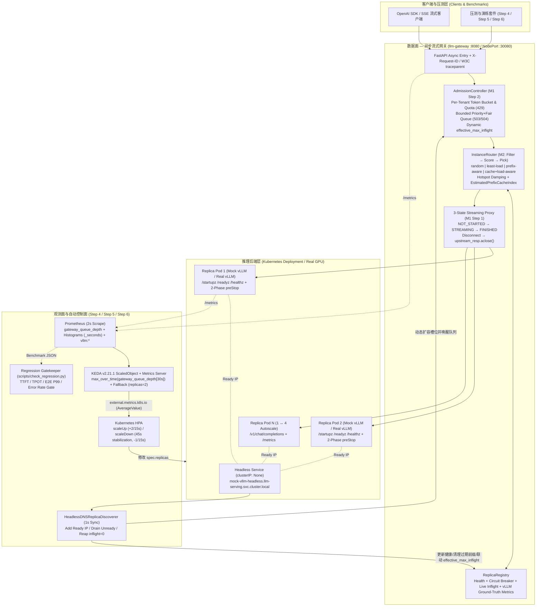
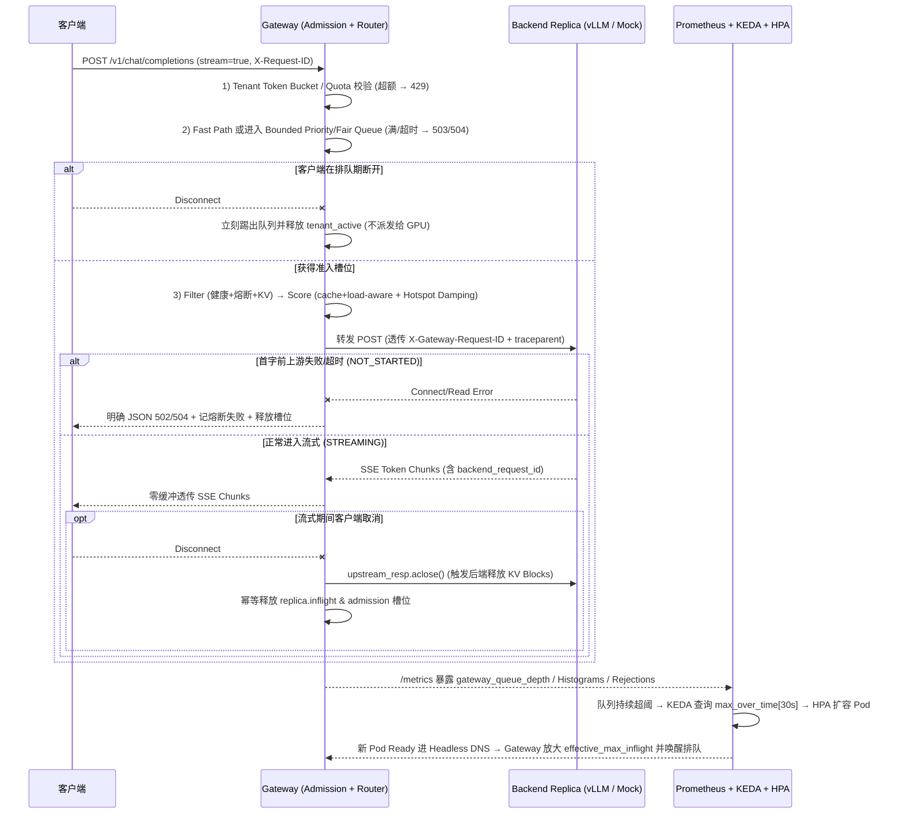

# vLLM Serving Lab — 系统全景架构文档（M0 → M3）

> 本文档汇总本仓库从单机基线（M0）、异步流式网关与准入控制（M1）、多副本前缀/负载感知路由（M2）、可观测性与自动回归门禁（Step 4）、Kubernetes 生命周期治理（Step 5）到 KEDA 队列驱动自动扩缩容（Step 6 / M3）的**完整端到端系统架构**。
>
> 核心架构决策与权衡取舍记录于 **[ADR 架构决策记录索引](adr/README.md)**。

---

## 1. 全栈全景架构图（数据面 / 控制面 / 观测面）

---

## 2. 端到端请求生命周期时序（含取消、故障与扩容联动）

---

## 3. 分层验证与证据矩阵（严格区分 Mock 控制面 vs 真实 GPU）

| 层次 | 验证目标 | 运行载体 | 关键代码与配置 | 实测证据报告与原始 JSON |
| :--- | :--- | :--- | :--- | :--- |
| **M0 单机基线** | 真实推理 16 组负载基线、Prefix Cache / Chunked Prefill / 量化实测 | **真实单卡 RTX 5080 + vLLM** | `scripts/benchmark.sh`, `scripts/run_exp*.sh` | [optimization_benchmarks_report.md](optimization_benchmarks_report.md), `results/baseline/summary.json` |
| **M1 异步网关 & 准入** | HTTP/SSE 转发、三态机、断连零泄漏、有界队列、`429/503/504`、公平与防饥饿 | 单元测试 + **真实单卡 RTX 5080 vLLM** | `gateway/app.py`, `gateway/admission.py`, `gateway/models.py` | [gateway.md](gateway.md), `tests/test_gateway_step{1,2}.py`, `tests/test_gateway_real_vllm.py` |
| **M2 多副本路由** | 4 种可切换策略、集群有效 KV 放大 $N$ 倍、热点倾斜 Cache vs Load 权衡 | Mock 多副本算法验证 + **真实单卡 RTX 5080 vLLM 物理校验** | `gateway/router.py`, `gateway/registry.py` | [gateway.md](gateway.md), `results/gateway/m2_*.json` |
| **Step 4 证据链与门禁** | Prometheus Histogram (`_seconds`)、全链路 Trace 关联、吞吐-尾延迟权衡、Goodput、回归门禁 | **真实单卡 RTX 5080 + vLLM** | `gateway/metrics.py`, `scripts/run_gateway_slo_benchmark.py`, `scripts/check_regression.py` | [slo_benchmark_regression_report.md](slo_benchmark_regression_report.md), `results/step4/*.json` |
| **Step 5 K8s 生命周期** | Headless DNS 发现、三探针隔离、两阶段 `preStop` 零丢包滚动发布、3 类实时故障演练 | 本地 **`kind` K8s 集群 + 3 Mock Replicas**（控制面验证） | `k8s/{mock-vllm,gateway,configmap}.yaml`, `gateway/discovery.py`, `mock_backend/server.py` | [k8s_lifecycle_report.md](k8s_lifecycle_report.md), `results/k8s/*.json` |
| **Step 6 队列自动扩缩容** | `gateway_queue_depth → Prometheus → KEDA → HPA → Deployment` 闭环、防抖、冷启动滞后、`fallback` | 本地 **`kind` + Prometheus + KEDA v2.21.1 + Mock Replicas**（控制面验证） | `k8s/{prometheus,keda-scaledobject}.yaml`, `scripts/run_keda_autoscaling_experiments.py` | [keda_autoscaling_report.md](keda_autoscaling_report.md), `results/k8s_autoscaling/*.json` |

---

## 4. 架构决策记录（ADR）索引

- **[ADR-0001](adr/0001-gateway-bounded-admission-queue.md)**：为什么采用独立异步网关与有界准入队列（分离 `429` / `503` 及独立于 vLLM 引擎队列）
- **[ADR-0002](adr/0002-cache-load-aware-routing-and-metric-separation.md)**：为什么采用带热点衰减的 `cache+load-aware` 路由，并严格隔离网关估计亲和度与真实 vLLM 命中率
- **[ADR-0003](adr/0003-k8s-headless-discovery-probes-and-graceful-drain.md)**：为什么在 Kubernetes 上采用 Headless Service DNS 发现、三探针职责分离与两阶段 `preStop` 流式优雅下线
- **[ADR-0004](adr/0004-keda-queue-driven-autoscaling-and-dynamic-capacity.md)**：为什么采用基于 `gateway_queue_depth` 的 KEDA 扩缩容、Gateway 动态并发联动、非对称防抖与 `fallback` 容错
