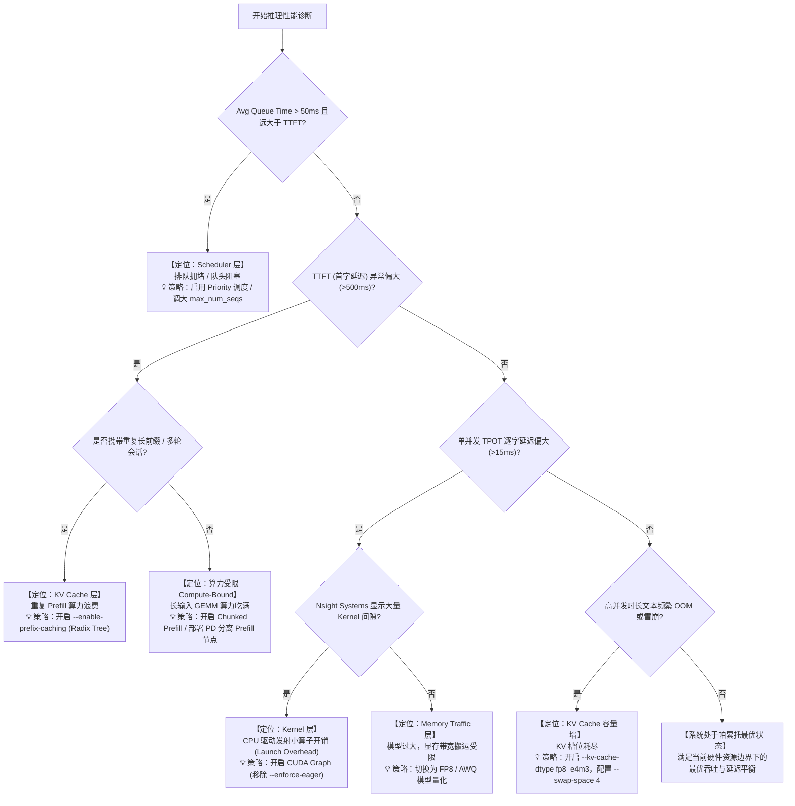

# 🔍 大模型推理服务七层瓶颈分析与诊断框架 (7-Layer Bottleneck Analysis Framework)

> **核心法则**：在大模型服务系统（LLM Serving）中，**“单一 GPU Utilization 绝对不能作为推断系统瓶颈的唯一证据”**。  
> 必须遵循系统化的 **分层下钻定位（7-Layer Triangulation）**，从调度、显存、带宽、算子、网络到宿主机平台层层递进，才能准确定位性能瓶颈并做出最优架构决策。

---

## 📑 目录

- [一、为什么单一 GPU Utilization 会导致严重误判？](#一为什么单一-gpu-utilization-会导致严重误判)
- [二、大模型推理服务七层瓶颈诊断框架 (7-Layer Model)](#二大模型推理服务七层瓶颈诊断框架-7-layer-model)
  - [Layer 1: Scheduler 层 (调度与队头阻塞)](#layer-1-scheduler-层-调度与队头阻塞)
  - [Layer 2: KV Cache 层 (容量墙与分页置换)](#layer-2-kv-cache-层-容量墙与分页置换)
  - [Layer 3: Memory Traffic 层 (显存带宽与访存瓶颈)](#layer-3-memory-traffic-层-显存带宽与访存瓶颈)
  - [Layer 4: Quantization 层 (量化收益 vs 解量化开销)](#layer-4-quantization-层-量化收益-vs-解量化开销)
  - [Layer 5: Kernel 层 (算子效率与驱动发射)](#layer-5-kernel-层-算子效率与驱动发射)
  - [Layer 6: Communication 层 (多卡互联与网络分流)](#layer-6-communication-层-多卡互联与网络分流)
  - [Layer 7: Platform / OS 层 (虚拟化、总线与驱动)](#layer-7-platform--os-层-虚拟化总线与驱动)
- [三、量化优化四维权衡模型 (Quantization Trade-off Matrix)](#三量化优化四维权衡模型-quantization-trade-off-matrix)
- [四、工业级瓶颈排查决策树 (Diagnostic Decision Tree)](#四工业级瓶颈排查决策树-diagnostic-decision-tree)

---

## 一、为什么单一 GPU Utilization 会导致严重误判？

在传统软件架构中，CPU/GPU 利用率打满通常意味着系统充分发挥了算力；但在 LLM 推理场景中，`nvidia-smi` 汇报的 **GPU Core Utilization** 存在三大致命“假象”：

### 假象 1：GPU 利用率高达 95%+，但生成吞吐（Tokens/s）极低
* **真相：显存带宽瓶颈（Memory-Bandwidth Bound）**。
* **机制**：在自回归解码（Decode）阶段，计算强度（Arithmetic Intensity）极低（`< 2 FLOPs/Byte`）。Tensor Core 处于绝大部分时间等待从 GDDR/HBM 显存拉取几十亿模型权重的“饥饿”状态。虽然硬件采样周期内检测到核心处于活动状态，但 SM（流多处理器）内部的大量 Warp 全在等待内存加载（Memory Stall）。

### 假象 2：GPU 利用率仅有 20%~30%，但请求延迟（P99）高得惊人
* **真相：CPU 驱动发射瓶颈（Kernel Launch Overhead）或排队阻塞（Queueing）**。
* **机制**：
  1. 在单并发或小 Batch 下，解码一步需要调用数十个小算子（RMSNorm、RoPE、GEMV、Activation）。每个 CUDA 算子的发射都需要 CPU 通过驱动层向 GPU 队列提交任务（耗时 ~5-10µs）。GPU 执行该算子仅需 2µs，导致 GPU 大量时间都在“等米下锅”。
  2. 若调度器队列存在队头阻塞（Head-of-Line Blocking），请求在进入 GPU 计算前已在 HTTP/调度等待队列中排队数百毫秒。

### 假象 3：GPU 利用率剧烈波动，流式客户端疯狂卡顿（Jitter 爆表）
* **真相：Prefill 与 Decode 混合调度碰撞**。
* **机制**：突发的长文本输入请求（如 2000+ Tokens）突然抢占算力，在未启用 Chunked Prefill 或 PD 分离的情况下，GPU 暂停所有正在打字的 Decode 请求，造成阅读感骤停。

---

## 二、大模型推理服务七层瓶颈诊断框架 (7-Layer Model)

```
┌────────────────────────────────────────────────────────────────────────┐
│            大模型推理服务的七层瓶颈诊断框架 (7-Layer Model)               │
└────────────────────────────────────────────────────────────────────────┘
  ▲
  ├── [Layer 1: Scheduler]    排队等待 (Queue Time) / FCFS队头阻塞 / Batch大小
  ├── [Layer 2: KV Cache]     显存容量上限 / Radix Tree 命中率 / CPU Swap置换
  ├── [Layer 3: Memory Traf]  Decode 显存带宽饱和 / 权重搬运与 KV Cache 读取
  ├── [Layer 4: Quantization] 解量化 ALU 开销 / Tensor Core 支持 / FP8 vs AWQ
  ├── [Layer 5: Kernel]       算子发射开销 / CUDA Graph / PagedAttention 效率
  ├── [Layer 6: Communicat]   Prefill-Decode 分离网络延迟 / TP All-Reduce 气泡
  └── [Layer 7: Platform]     WSL2 Pin Memory / PCIe 带宽 / 驱动调度
```

### Layer 1: Scheduler 层 (调度与队头阻塞)
* **典型症状**：`request_queue_time_seconds` 显著增加，且在有新请求到达时 TTFT 骤增数十倍。
* **根因分析**：低优先级批量长文本任务占据运行槽位（`max_num_seqs`），高优先级实时交互请求排在队尾无法插队。
* **验证工具**：Grafana Panel 10 (`Avg Queue Time`) 与 Panel 4 (`Scheduler State: waiting vs running`)。
* **工程解法**：启用 `--scheduling-policy priority` 并根据用户身份打标；动态配置 `max_num_seqs`。

### Layer 2: KV Cache 层 (容量墙与分页置换)
* **典型症状**：随着并发连接增多，新请求触发中断或延迟突刺；Prometheus 报告 `cpu_cache_usage_perc > 0`。
* **根因分析**：随着上下文膨胀，GPU KV Cache 池耗尽。
  - **vLLM V0 旧版机制**：触发向 Host RAM 的响应式抢占换出（Swap Thrashing），产生严重的 PCIe 搬运延迟抖动。
  - **vLLM V1 现代演进**：**vLLM V1 已彻底移除旧式 GPU↔CPU 响应式抢占换出机制**，转而采用重计算（`RECOMPUTE`）以保证调度器轻量化。而现代 **KV Offloading** 则属于主动分层存储（Tiered Cache，如 LMCache / Mooncake / CPU 前缀主动沉降），其设计是在上下文生命周期中异步把冷 KV Cache 换出到 CPU RAM 或 NVMe SSD 以供跨请求复用，与旧版应急抢占换出不可混为一谈。
* **验证工具**：Grafana Panel 6 (`Cache Utilization`)、Panel 14 (`GPU & CPU Cache`)。
* **工程解法**：开启 `--kv-cache-dtype fp8_e4m3`（容量翻倍）；开启 `--enable-prefix-caching` 复用公共前缀；在 V0 引擎中配置 `--swap-space 4` 保底防 OOM，在 V1 引擎中配置主动分层缓存（Tiered Storage）。

### Layer 3: Memory Traffic 层 (显存带宽与访存瓶颈)
* **典型症状**：高并发纯生成场景下，Tokens/s 无法随着算力提升线性增长；GPU 功率（Watts）维持中等偏低水平。
* **根因分析**：自回归单字生成需要频繁读取全部模型权重与累积的 KV 缓存，系统受限于 GPU 物理显存带宽（如 RTX 5080 的 GDDR7 带宽或 A100 的 HBM 带宽）。
* **验证工具**：`vllm:generation_tokens_total` vs 理论显存带宽上限公式：
  $$\text{Max Throughput (tok/s)} \approx \frac{\text{Memory Bandwidth (GB/s)}}{\text{Model Weight Size (GB)} + \text{KV Cache Size per Token (GB)}}$$
* **工程解法**：采用权重量化（AWQ 4-bit / FP8 8-bit），直接让权重显存搬运量减半，带宽利用率成倍放大。

### Layer 4: Quantization 层 (量化收益 vs 解量化开销)
* **典型症状**：使用了 4-bit 量化模型，但小 Batch 下单字生成速度反而不如 FP8，甚至推理吞吐不升反降。
* **根因分析**：详见第三节“量化优化四维权衡模型”。Weight-Only 4-bit 量化需要额外的运行时解量化（Dequantization）步骤，消耗 ALU 算力。
* **验证工具**：`test_quantization.py` 横向对比 BF16 vs AWQ vs FP8 的 TPOT 与 Weights 显存占用。

### Layer 5: Kernel 层 (算子效率与驱动发射)
* **典型症状**：小并发（c=1）时单字生成间隔（TPOT）居高不下；在 Nsight Systems 中观察到大量内核发射空隙。
* **根因分析**：CPU 驱动发射小 Kernel 的开销超过了 GPU 实际执行时间（Host-bound）。
* **验证工具**：`bash scripts/profile_service.sh --nsys` 查看 Kernel Launch 间隙；对比 `--enforce-eager` 开关。
* **工程解法**：启用 CUDA Graph 图执行预录（消除数百个小算子的发射延迟）。

### Layer 6: Communication 层 (多卡互联与网络分流)
* **典型症状**：单机多卡或 PD 分离架构下，P99 延迟显著高于单节点基线。
* **根因分析**：
  - **TP 通信**：Tensor Parallelism（TP）的 All-Reduce 算子通信受限于 PCIe 或 NVLink 带宽。
  - **真·PD 分离传输开销**：在真正的 Prefill-Decode Disaggregation 架构中，依赖 **KV Connector（如 PyNcclConnector / Mooncake）** 跨节点传输 KV Cache。若节点间缺乏高带宽 RDMA/NVLink，KV 传输时间可能吞噬 Prefill 节省的时间。
  - **应用层分流代理**：若使用轻量 HTTP 分流网关（如 `clients/disagg_router.py`），则无 KV 跨节点搬运开销，属于请求级长短隔离。
* **验证工具**：`scripts/run_exp9_disaggregation.sh` 对比 Monolithic vs Disaggregated 的网络代理延迟与 Jitter。

### Layer 7: Platform / OS 层 (虚拟化、总线与驱动)
* **典型症状**：在 Windows WSL2 启动时频繁报 `cannot pin memory` 错误，或数据加载极慢。
* **根因分析**：WSL2 虚拟化内存管理对 CUDA 统一寻址（Unified Memory）与固定内存页（Pinned Memory）的支持约束。
* **工程解法**：配置 `VLLM_WSL2_ENABLE_PIN_MEMORY=1`；将工作空间建在 WSL2 内部而非 `/mnt/c`。

---

## 三、量化优化四维权衡模型 (Quantization Trade-off Matrix)

大模型推理中，量化优化绝对不是“比特数越低越好”，必须在以下四个维度综合评估：

```
┌────────────────────────────────────────────────────────────────────────┐
│                        量化优化的四维博弈模型                          │
└────────────────────────────────────────────────────────────────────────┘
              1. Memory Traffic (显存搬运量) ── 越小越好
                                  ▼
              2. Dequantization Cost (解量化开销) ── 额外算力代价
                                  ▼
              3. Kernel Efficiency (算子执行效率) ── 寄存器与共享内存占用
                                  ▼
              4. Tensor Core Support (硬件原生支持) ── 硬件原生乘加指令
```

| 量化策略 | 显存带宽流量 (Memory Traffic) | 解量化开销 (Dequantization Cost) | Tensor Core 原生支持 | 最佳适用场景 |
| :--- | :---: | :---: | :---: | :--- |
| **BF16 / FP16** (未量化) | **基准 (1.0x)**<br>每个参数搬运 2 字节 | **零开销 (0)**<br>原生浮点格式 | ✅ 原生支持 (TC) | 极小规模模型 (<=3B) 或算力充裕、无显存压力的离线批处理。 |
| **AWQ (W4A16)** (4-bit 权重) | **极低 (~0.25x)**<br>参数搬运量大幅减少 75% | **⚠️ 存在开销**<br>GEMM 计算前需由 ALU 将 INT4 解包为 FP16 | ❌ 仅 GEMM 支持，解包占用额外的 CUDA Core | **显存受限严重单卡**（如 16GB 跑 8B 模型）。虽有解量化代价，但带宽红利远超计算开销。 |
| **FP8 (W8A8 / E4M3)** (8-bit 全量) | **低 (~0.5x)**<br>参数与激活搬运量腰斩 50% | **⚡ 零额外开销**<br>硬件直接吞吐 FP8 矩阵乘 | ✅ **Ada/Blackwell/Hopper 原生硬件支持** | **现代显卡黄金标准**。无解量化惩罚，直接激活 FP8 Tensor Core 峰值算力，兼顾极致吞吐与精度。 |

---

## 四、工业级瓶颈排查决策树 (Diagnostic Decision Tree)


