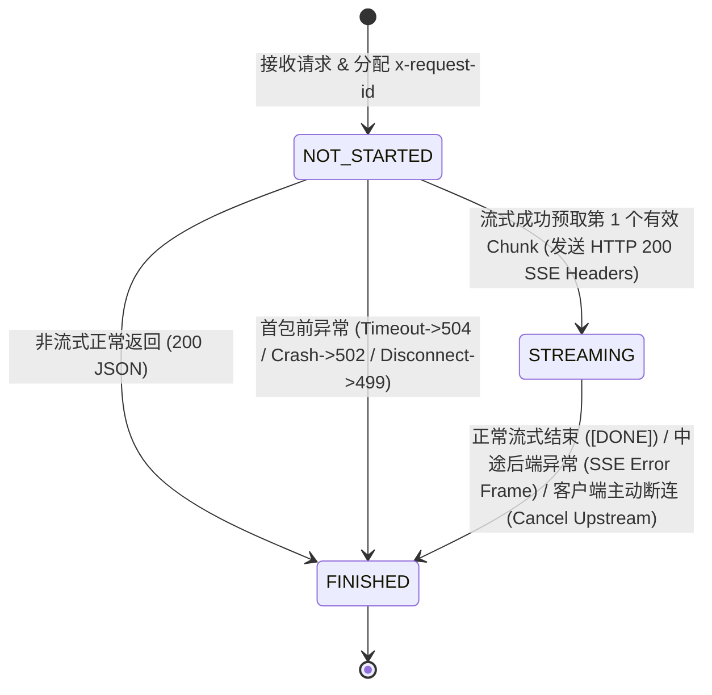
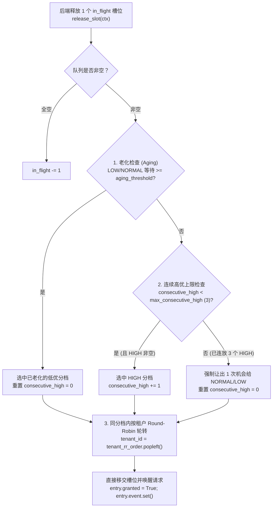
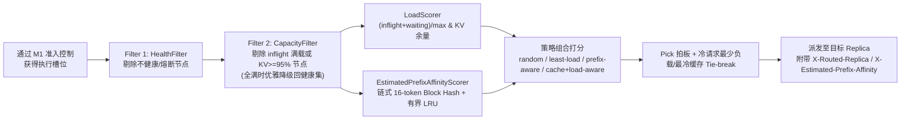

# 🌐 大模型服务网关与路由设计与实测报告 (M1 & M2: Async Gateway, Admission Control & Prefix-Aware Routing)

> **对应里程碑**：Milestone 1 (M1：请求生命周期、异步流式透传与准入过载保护) + Milestone 2 (M2：多实例注册表与 `Filter → Score → Pick` 路由)  
> **核心代码目录**：[`gateway/`](../gateway/)（[`app.py`](../gateway/app.py)、[`admission.py`](../gateway/admission.py)、[`registry.py`](../gateway/registry.py)、[`router.py`](../gateway/router.py)、[`config.py`](../gateway/config.py)、[`models.py`](../gateway/models.py)）  
> **验证测试套件**：[`tests/test_gateway_step1.py`](../tests/test_gateway_step1.py)（M1 Step 1 故障注入）、[`tests/test_gateway_real_vllm.py`](../tests/test_gateway_real_vllm.py)（M1 真机 vLLM 集成测试）、[`tests/test_gateway_step2.py`](../tests/test_gateway_step2.py)（M1 Step 2 准入控制）、[`tests/test_gateway_m2_routing.py`](../tests/test_gateway_m2_routing.py)（M2 注册表与路由单元）、[`tests/test_gateway_m2_benchmarks.py`](../tests/test_gateway_m2_benchmarks.py)（M2 物理仿真 4 场景四策略对比）、[`tests/test_gateway_m2_real_vllm.py`](../tests/test_gateway_m2_real_vllm.py)（M2 单卡 RTX 5080 真实 vLLM 校验）  
> **实测落盘数据**：[`step1_failure_tests.json`](../results/gateway/step1_failure_tests.json)、[`step1_real_vllm_integration.json`](../results/gateway/step1_real_vllm_integration.json)、[`step2_admission_tests.json`](../results/gateway/step2_admission_tests.json)、[`m2_routing_tests.json`](../results/gateway/m2_routing_tests.json)、[`m2_mock_policy_comparison.json`](../results/gateway/m2_mock_policy_comparison.json)、[`m2_real_vllm_verification.json`](../results/gateway/m2_real_vllm_verification.json)

---

## 目录

1. [为什么在 vLLM 前必须自建一层 HTTP Gateway？](#1-为什么在-vllm-前必须自建一层-http-gateway)
2. [M1 Step 1：最小异步流式转发与请求生命周期控制](#2-m1-step-1最小异步流式转发与请求生命周期控制)
   - [2.1 核心架构与三态状态机 (`NOT_STARTED` → `STREAMING` → `FINISHED`)](#21-核心架构与三态状态机-not_started--streaming--finished)
   - [2.2 关键工程实现细节](#22-关键工程实现细节)
   - [2.3 为什么发出 HTTP 200 Headers 后不能再改回 502 JSON？（首包预取设计）](#23-为什么发出-http-200-headers-后不能再改回-502-json首包预取设计)
   - [2.4 故障注入与边界测试实测报告 (`step1_failure_tests.json`)](#24-故障注入与边界测试实测报告-step1_failure_testsjson)
   - [2.5 真机 vLLM 端到端与断连回收实测报告 (`step1_real_vllm_integration.json`)](#25-真机-vllm-端到端与断连回收实测报告-step1_real_vllm_integrationjson)
3. [M1 Step 2：准入控制（Admission Control）、有界队列与过载反压](#3-m1-step-2准入控制admission-control有界队列与过载反压)
   - [3.1 核心设计思想（参考 llm-d EPP Flow Control 四大支柱）](#31-核心设计思想参考-llm-d-epp-flow-control-四大支柱)
   - [3.2 状态码反压语义严格分离（`429` vs `503` vs `504`）](#32-状态码反压语义严格分离429-vs-503-vs-504)
   - [3.3 优先级防饥饿与多租户 Round-Robin 公平调度算法](#33-优先级防饥饿与多租户-round-robin-公平调度算法)
   - [3.4 M1 Step 2 自动化压测与边界实测报告 (`step2_admission_tests.json`)](#34-m1-step-2-自动化压测与边界实测报告-step2_admission_testsjson)
4. [M2：多实例注册表（`ReplicaRegistry`）与可切换智能路由（`Filter → Score → Pick`）](#4-m2多实例注册表replicaregistry与可切换智能路由filter--score--pick)
   - [4.1 `ReplicaRegistry` 状态建模与“估计亲和度 vs 真实缓存命中”严格边界](#41-replicaregistry-状态建模与估计亲和度-vs-真实缓存命中严格边界)
   - [4.2 `Filter → Score → Pick` 流水线与 4 种可切换路由策略](#42-filter--score--pick-流水线与-4-种可切换路由策略)
   - [4.3 M2 自动化测试与四策略对比实测报告 (`m2_routing_tests.json`)](#43-m2-自动化测试与四策略对比实测报告-m2_routing_testsjson)
   - [4.4 M2 Part A：Mock 多副本 4 场景 Before/After 与冲突基准报告 (`m2_mock_policy_comparison.json`)](#44-m2-part-amock-多副本-4-场景-beforeafter-与冲突基准报告-m2_mock_policy_comparisonjson)
   - [4.5 M2 Part B：单卡 RTX 5080 真实 vLLM 行为与 `/metrics` 缓存命中交叉校验 (`m2_real_vllm_verification.json`)](#45-m2-part-b单卡-rtx-5080-真实-vllm-行为与-metrics-缓存命中交叉校验-m2_real_vllm_verificationjson)

---

## 1. 为什么在 vLLM 前必须自建一层 HTTP Gateway？

在 Milestone 0 (M0) 中，压测客户端直接请求单台 vLLM (`http://localhost:8000`) 以测出引擎裸机性能上限（Golden Baseline）。但在进入真实生产环境或多机路由前，**必须先在客户端与 vLLM 之间插入一层自研异步网关（Gateway）**：

1. **客户端断连即时止损（Disconnect Propagation & KV Block Reclamation）**：
   - 用户在网页端点击“停止生成”或网络断开时，若缺少网关层的 `request.is_disconnected()` 监听与 `upstream_resp.aclose()` 主动断流，后端 vLLM 仍可能继续空跑数百个 Decode Step，白白占用宝贵的 GPU 算力与 KV Cache 物理块。
2. **精细化四维超时与状态敏感错误处理（4D Timeouts & State-Aware Error Semantics）**：
   - LLM 推理具有独特的两阶段耗时特征：Prefill 阶段首字等待（TTFT）可能长达数秒，而 Decode 阶段相邻 Token 间隔（TPOT）仅数十毫秒。网关层通过 `httpx.Timeout(connect, read, write, pool)` 独立控制建连超时、流式单步读取超时与连接池等待超时。
3. **统一请求追踪与可观测性锚点（`x-request-id` & TTFT/E2E Attribution）**：
   - 网关为每个请求生成或透传全链路唯一的 `x-request-id`，并在网关侧精确记录 `ttft_ms`、`e2e_ms` 与生命周期终态，解耦客户端与后端引擎日志。
4. **控制变量法（为什么 Step 1 只连单台 vLLM，不做智能路由？）**：
   - 如果同时写网关转发与多节点路由，一旦出现 SSE 丢帧、连接池耗尽（`PoolTimeout`）或客户端断连后 GPU 仍在空跑，将无法定位是流式代理生命周期 Bug 还是路由算法 Bug。因此 **M1 Step 1 严格锁定单台 Backend**，把连接生命周期与异常语义验证到 100% 零泄漏。

---

## 2. M1 Step 1：最小异步流式转发与请求生命周期控制

### 2.1 核心架构与三态状态机 (`NOT_STARTED` → `STREAMING` → `FINISHED`)

在 [`gateway/models.py`](../gateway/models.py) 中，每一个进入网关的请求由 [`RequestContext`](../gateway/models.py#L22-L54) 追踪，并严格遵循单向三态状态机（[`RequestLifecycleState`](../gateway/models.py#L14-L19)）：



| 状态枚举 | 物理含义 | HTTP 响应头是否已发出？ | 发生异常时的合法处理方式 |
| :--- | :--- | :---: | :--- |
| **`NOT_STARTED`** | 请求刚进入网关，正在建连或等待后端返回第一个有效字节（Prefill 阶段） | **否** | 可干净地返回标准 HTTP 错误码与 JSON（超时 `504`、上游崩溃/拒绝 `502`、客户端提前断开 `499`） |
| **`STREAMING`** | 网关已收到后端第一个有效数据块，并向客户端发出了 `HTTP/1.1 200 OK` (`text/event-stream`) | **是（不可逆）** | **严禁再尝试修改 HTTP 状态码**；必须通过流内追加 `data: {"error": {"type": "mid_stream_error", ...}}\n\n` + `data: [DONE]\n\n` 通知客户端，并在 `finally` 中关闭上游连接 |
| **`FINISHED`** | 请求生命周期终结（正常完成、异常终止或客户端断连取消） | 已完成 | 幂等触发 `upstream_resp.aclose()` 归还/销毁连接，活跃计数器 `active_requests` 减 1 |

---

### 2.2 关键工程实现细节

1. **进程级 `httpx.AsyncClient` 连接池复用**（[`gateway/app.py`](../gateway/app.py#L64-L81)）：
   - 通过 FastAPI `lifespan` 上下文在进程启动时初始化全局唯一的 `httpx.AsyncClient`，配置 `httpx.Limits(max_connections=200, max_keepalive_connections=50, keepalive_expiry=30.0)`。
   - 严禁在每个请求函数内 `async with httpx.AsyncClient()` 创建临时客户端，彻底消除高并发下的 TCP 三次握手开销与临时端口耗尽风险。
2. **零缓冲逐块流式透传（Zero-Buffering SSE Passthrough）**（[`gateway/app.py`](../gateway/app.py#L227-L296)）：
   - 使用 `req = client.build_request(...)` + `upstream_resp = await client.send(req, stream=True)` 手动接管上游流生命周期（避免 `async with client.stream()` 在 `StreamingResponse` 返回瞬间提前关闭上游流）。
   - 使用 `upstream_resp.aiter_raw()` 按原始网络字节块逐块 `yield` 给客户端，**绝不在网关内存中拼接或缓存完整回答**，保证极低的内存水位与微秒级逐块转发延迟。
3. **双路客户端断连检测与上游即刻取消**：
   - 在每次 `yield` 前后检查 `await request.is_disconnected()`；同时当客户端主动关闭 socket 时，Starlette 底层 `listen_for_disconnect` 会取消消费协程并在生成器挂起点注入 `asyncio.CancelledError` / `GeneratorExit`。
   - 生成器 `finally:` 块确保**无论以何种路径退出（正常结束、客户端断连、后端中途崩溃、读取超时），必定执行 `await upstream_resp.aclose()`**，立刻触发向 vLLM 的 TCP 连接中断/关闭，让 vLLM 引擎终止该请求的后续 Decode 步。

---

### 2.3 为什么发出 HTTP 200 Headers 后不能再改回 502 JSON？（首包预取设计）

- **协议层原因**：在 HTTP/1.1 的分块传输（`Transfer-Encoding: chunked`）与 SSE 协议中，状态行（`HTTP/1.1 200 OK`）和响应头（`Content-Type: text/event-stream`）在第一个响应字节通过网卡发出前就已经写入 TCP 字节流。HTTP 协议没有“撤回已发送响应头”的机制。
- **首包预取（First-Chunk Pre-fetch）技巧**（[`gateway/app.py`](../gateway/app.py#L194-L225)）：
  - 如果后端已经发回了 HTTP 200 响应头，但在 Prefill 算第一个 Token 时发生 GPU OOM 崩溃或 `ReadTimeout`，普通的流式代理由于此时已经构造并返回了 `StreamingResponse`，会导致客户端收到 `200 OK` 空流。
  - 我们在进入 `StreamingResponse` **之前**（仍处于 `NOT_STARTED` 状态），先手动执行一次 `first_chunk = await anext(chunk_iter, b"")`。
  - **收益**：若后端在吐出第 1 个 Token 前超时或崩溃，异常会在 `NOT_STARTED` 阶段被捕获，网关直接向客户端返回干净的 **HTTP `504 Gateway Timeout` 或 `502 Bad Gateway` JSON**！只有当 `first_chunk` 真正到达网关后，才调用 `ctx.mark_streaming()` 切换至 `STREAMING` 状态并把 `first_chunk` 连同后续流交给 `StreamingResponse`。

---

### 2.4 故障注入与边界测试实测报告 (`step1_failure_tests.json`)

通过 [`tests/test_gateway_step1.py`](../tests/test_gateway_step1.py) 针对 6 类核心正常与故障注入场景进行自动化验证，运行命令：

```bash
python -m pytest tests/test_gateway_step1.py -v
```

**实测结果汇总（`6 passed in 0.96s`，完整数据见 [`results/gateway/step1_failure_tests.json`](../results/gateway/step1_failure_tests.json)）**：

| 测试场景 | 故障注入方式 | 生命周期状态变迁 | 实测观测结果 | 上游流关闭 (`upstream_closed`) | 泄漏请求数 (`leaked_active_requests`) |
| :--- | :--- | :--- | :--- | :---: | :---: |
| **1. 非流式正常转发** | `stream=false` 正常返回 JSON | `NOT_STARTED` → `FINISHED` | HTTP `200`，透传 `x-request-id` 与 `x-gateway-ttft-ms` | `true` | `0` |
| **2. 流式正常透传** | `stream=true` 连续发射 4 个 SSE 帧 | `NOT_STARTED` → `STREAMING` → `FINISHED` | HTTP `200`，完整收到 `hello` + ` world` + `[DONE]`（共 4 块） | `true` | `0` |
| **3. 首字前失败（Pre-First-Token）** | 后端在首字前超时 (`ReadTimeout`) 或发完 200 头后首包前崩溃 (`RemoteProtocolError`) | `NOT_STARTED` → `FINISHED` | 超时精准返回 **HTTP `504`** JSON；崩溃精准返回 **HTTP `502`** JSON | `true` | `0` |
| **4. 流式中途失败（Mid-Stream）** | 后端成功发出第 1 个 Token 后，在第 2 个 Token 处断流崩溃 | `NOT_STARTED` → `STREAMING` → `FINISHED` | 已承诺 **HTTP `200`** 不可更改；网关在流内优雅追加 `type: "mid_stream_error"` SSE 错误帧 + `[DONE]` | `true` | `0` |
| **5. 客户端收到若干 Token 后主动断开** | 后端计划生成 100 个 Token，客户端收到 **2 个 chunk** 后立刻发送 ASGI `http.disconnect` | `NOT_STARTED` → `STREAMING` → `FINISHED` | 后端实际仅生成 **2 个 chunk** 即被网关取消关闭（省去后续 98 个 Token 的空跑浪费） | `true` | `0` |
| **6. 慢客户端读取 + 25 并发压测** | **25 路并发流式请求**（含 **5 个慢客户端**每 chunk 延迟 `40ms`） | 全部归入 `FINISHED` | 快慢客户端互不阻塞，25 路全部完整收包，无连接池耗尽 | `true` | `0` |

---

### 2.5 真机 vLLM 端到端与断连回收实测报告 (`step1_real_vllm_integration.json`)

在本地 Docker 容器启动真实 vLLM (`vllm/vllm-openai:v0.25.1`，模型 `RedHatAI/Qwen2.5-7B-Instruct-FP8-dynamic`，RTX 5080 Laptop GPU)，通过 [`tests/test_gateway_real_vllm.py`](../tests/test_gateway_real_vllm.py) 进行端到端验证：

```bash
docker compose up -d vllm
python -m pytest tests/test_gateway_real_vllm.py -v
```

**真机实测结果（`1 passed in 2.02s`，完整数据见 [`results/gateway/step1_real_vllm_integration.json`](../results/gateway/step1_real_vllm_integration.json)）**：

| 验收维度 | 实测指标与表现 | 结论 |
| :--- | :--- | :---: |
| **后端模型发现 (`GET /v1/models`)** | 成功通过 Gateway 识别真实 vLLM 模型 `qwen2.5-7b-instruct-fp8` | ✅ PASS |
| **非流式端到端问答 (`stream=false`)** | HTTP `200`，端到端延迟 **`366.64 ms`**，回复 `"Hi there!"` | ✅ PASS |
| **流式 SSE 零丢帧校验 (`stream=true`)** | 首字延迟 **TTFT = `59.22 ms`**，连续接收 **34 个 SSE 数据帧** + `data: [DONE]`，逐帧 JSON 解析零损坏，完整还原 `"Sure! Here is the count from 1 to 10:\n\n1, 2, 3, 4, 5, 6, "` | ✅ PASS |
| **客户端断连 → 真实 vLLM 停止 Decode 验证** | 发起 `max_tokens=300` 长生成请求，客户端收到 **3 个 chunk** 后主动断开 ASGI 连接 → 网关触发 `upstream_resp.aclose()` → 轮询真实 vLLM `/metrics`，**`164.94 ms` 内 `vllm:num_requests_running` 彻底归零 (`0.0`)**，网关 `leaked_active_requests = 0` | ✅ PASS |

---

## 3. M1 Step 2：准入控制（Admission Control）、有界队列与过载反压

### 3.1 核心设计思想（参考 llm-d EPP Flow Control 四大支柱）

当外部到达流量超过后端 vLLM 的并发能力时，如果网关直接将所有请求透传进后端，会导致后端内部队列无限膨胀、高优请求队头阻塞，且在多实例路由（M2）下引发 **“调度悔恨（Scheduling Regret / 过早绑定）”**。

因此在 [`gateway/admission.py`](../gateway/admission.py) 中，我们实现了 [`AdmissionController`](../gateway/admission.py#L103-L459)，落地了 `llm-d EPP` 的四大核心流控机制：

1. **饱和检测与 Work-Conserving 直通（Saturation）**：
   - 默认配置 `max_inflight = 4`，`queue_capacity = 20`。
   - 当 `in_flight < max_inflight` 且队列为空时，请求 **0 排队延迟**直接获得执行槽位发往后端；仅当 `in_flight == max_inflight` 进入饱和态时才激活网关有界队列。
2. **逻辑流分类（Flow Classification）**：
   - 提取请求头 `X-Tenant-ID`（或请求体 `tenant_id`/`user`）与 `X-Priority`（`high` / `normal` / `low`），构建 `FlowKey = (tenant_id, priority)`。
3. **两级公平调度与防饥饿（Priority + Per-Tenant Fairness + Anti-Starvation）**：
   - **同优先级内（Per-Tenant Round-Robin）**：每个优先级分档内按租户维护独立 FIFO 子队列与轮转环（`tenant_rr_order`），每次出队在有积压的租户间交替轮转，彻底防止“吵闹邻居（Noisy Neighbor）”饿死其他租户。
   - **跨优先级间（Consecutive Cap + Aging 防永久饥饿）**：默认优先调度 `high`；但通过 `max_consecutive_high_priority = 3` 与 `starvation_aging_seconds` 保底：当连续放行 3 个 `high` 请求且低优队列非空时，**强制将第 4 个槽位让给等待中的 `normal` / `low` 请求**，从数学上保证低优先级请求绝不永久饥饿。
4. **排队与执行双态取消/超时清理（Direct Slot Handoff）**：
   - 排队期间实时监听 `request.is_disconnected()` 与 `queue_timeout` / `deadline`；一旦客户端在排队期间断开连接，立即从有界队列中摘除该节点，绝不浪费后续释放的后端槽位。
   - 当执行态请求完成、超时或断连时，在 `finally` 中幂等调用 `admission.release_slot(ctx)`，采用**槽位直接移交（Direct Handoff）**机制唤醒下一个排队请求，防止新到达请求插队（Barging）。

---

### 3.2 状态码反压语义严格分离（`429` vs `503` vs `504`）

| HTTP 状态码 | 错误类型 (`error.type`) | 触发条件与物理含义 | 响应头契约 |
| :---: | :--- | :--- | :--- |
| **`429 Too Many Requests`** | `rate_limit_exceeded` / `tenant_quota_exceeded` | **单租户违规**：该租户超过 Token Bucket 速率上限（`tenant_rate_limit_rps`）或单租户最大并发配额（`tenant_max_concurrency`），此时系统全局可能仍有空闲，不影响其他正常租户。 | `X-Request-ID`, `Retry-After` |
| **`503 Service Unavailable`** | `server_overloaded_queue_full` / `queue_timeout_exceeded` | **系统级过载反压**：后端 `in_flight == max_inflight` 已满，且网关有界队列已达上限（`queued == queue_capacity`），或请求在网关队列中等待超过 `queue_timeout`。 | `X-Request-ID`, `Retry-After` |
| **`504 Gateway Timeout`** | `deadline_exceeded` / `gateway_timeout` | **全链路截止时间或后端超时**：请求携带的 `X-Request-Deadline-Seconds` 在排队或执行阶段耗尽，或后端 vLLM 首字/生成超时。 | `X-Request-ID` |

---

### 3.3 优先级防饥饿与多租户 Round-Robin 公平调度算法



---

### 3.4 M1 Step 2 自动化压测与边界实测报告 (`step2_admission_tests.json`)

通过 [`tests/test_gateway_step2.py`](../tests/test_gateway_step2.py) 对照学习计划中的 5 大硬性验收场景进行测试：

```bash
python -m pytest tests/test_gateway_step1.py tests/test_gateway_step2.py -v
```

**实测结果汇总（`12 passed in 2.13s`，完整落盘数据见 [`results/gateway/step2_admission_tests.json`](../results/gateway/step2_admission_tests.json)）**：

| 测试编号与验收场景 | 设定参数 (`max_inflight=4, queue_capacity=20`) | 实测核心数据与证据 (`step2_admission_tests.json`) | 结论 |
| :--- | :--- | :--- | :---: |
| **1. 并发突发超 24 请求 + 队列有界与恢复**<br>(`test_1_burst_over_24_bounded_queue_and_recovery`) | 瞬间并发打入 **32 个请求**，Mock Backend 固定耗时 `40ms` | • 后端最大实测并发：`max_observed_backend_inflight = 4`（严守上限 4）<br>• 队列最大实测长度：`max_observed_queue_len = 20`（严守上限 20，绝不无限增长）<br>• **24 个成功 (`200 OK`)**，**8 个溢出当场返回 `503`**<br>• 洪峰结束后 `in_flight=0, queued=0`，补发恢复请求 `200 OK` (`queue_wait_ms=0.0`) | ✅ PASS |
| **2. 租户配额/速率限制 (`429`) + 多租户争抢公平性**<br>(`test_2_tenant_quota_rate_limit_429_and_fairness`) | • 租户配额 `2` / 速率桶突发 `2`<br>• `tenant-noisy` 狂塞 6 个排队后，`tenant-quiet` 发 2 个 | • 单租户超限精准返回 **`429`**，同时其他租户返回 **`200`**<br>• 排队出队序列实测为：`["tenant-noisy", "tenant-quiet", "tenant-noisy", "tenant-quiet", ...]`，安静租户无需排在吵闹租户 6 个请求之后 | ✅ PASS |
| **3. 高优持续涌入 + 低优防永久饥饿**<br>(`test_3_continuous_high_priority_flood_no_low_priority_starvation`) | 先入队 **3 个 `low`**，随后持续涌入 **9 个 `high`**（配置 `max_consecutive_high=3`） | • 实测 12 个排队请求的出队顺序：<br>`["high", "high", "high", "low", "high", "high", "high", "low", "high", "high", "high", "low"]`<br>• 高优成功插队享受 3:1 带宽，同时每 3 个 `high` 后必保底放行 1 个 `low`，**`low_priority_starved_count = 0`** | ✅ PASS |
| **4. 客户端在排队期间主动取消**<br>(`test_4_client_cancel_in_queue_evicts_cleanly_and_preserves_slots`) | 4 个请求占满槽位，第 5 个请求 (`req-cancel-in-queue`) 排队中途断开，第 6 个 (`req-survivor`) 排在后面 | • `cancelled_in_queue_count = 1`<br>• `cancelled_request_sent_to_backend = false`（绝不白送后端浪费算力）<br>• 槽位释放时直接唤醒第 6 个请求 `req-survivor` (`200 OK`)，最终 `in_flight=0, queued=0` | ✅ PASS |
| **5. 排队超时 (`503`)、全链路 Deadline (`504`) 与后台超时回收**<br>(`test_5_queue_timeout_deadline_and_backend_timeout_slot_recovery`) | `queue_timeout=40ms`，请求级 `X-Request-Deadline-Seconds: 0.02 / 0.04` | • 排队等槽位超时返回 **`503`** (`queue_timeout_exceeded`)<br>• 全链路 Deadline 在排队或执行态耗尽返回 **`504`** (`deadline_exceeded` / `gateway_timeout`)<br>• 超时后槽位 `100%` 回收 (`in_flight=0, queued=0`)，后续 4 个并发请求全部 `200 OK` | ✅ PASS |
| **6. 四大通关指标与无效请求 100% 拦截验证**<br>(`test_6_pass_criteria_metrics_and_invalid_requests_blocked`) | 发送损坏 JSON (`400`)、缺 `messages` (`400`)、过期 Deadline (`504`)、超配额 (`429`) | • `invalid_and_rejected_entered_backend_count = 0`（无效请求 100% 拦截在推理队列前）<br>• `/admin/admission` 与 `/metrics` 完整暴露 `queue_depth`、`queue_wait`、`reject`、`cancel` 四大指标族 | ✅ PASS |

---

## 4. M2：多实例注册表（`ReplicaRegistry`）与可切换智能路由（`Filter → Score → Pick`）

### 4.1 `ReplicaRegistry` 状态建模与“估计亲和度 vs 真实缓存命中”严格边界

在 [`gateway/registry.py`](../gateway/registry.py) 中，[`ReplicaRegistry`](../gateway/registry.py#L140-L296) 为每个后端 vLLM 实例维护完整的运行时状态 [`ReplicaState`](../gateway/registry.py#L28-L115)：

* **端点与健康熔断**：`endpoint`、`healthy`、`consecutive_failures`、`circuit_open_until`（连续后端传输失败达到阈值自动熔断冷却，同时支持 `POST /admin/replicas/{id}/health` 手动摘流/恢复）。
* **实时负载与容量提示（Capacity Hints）**：
  * `inflight`（Gateway 实时在途并发，请求派发时 `+1`，任何正常/异常/断连退出路径幂等 `-1`）
  * `max_inflight`（单实例并发容量上限提示）
  * `backend_waiting_queue` / `backend_running_requests`（来自 vLLM `/metrics` 或运行期提示）
  * `kv_cache_usage_perc` / `kv_cache_capacity_blocks`（KV 显存占用率与容量块数提示）
* **关键红线——严格隔离“估计亲和度”与“真实 vLLM Cache Hit”**：
  * 网关层 [`EstimatedPrefixCacheIndex`](../gateway/router.py#L121-L185) 仅根据历史路由记录 + 链式 Token-Prefix Block Hash + 有界 LRU 估算亲和度，所有响应头与指标均显式标注 **`estimated_prefix_affinity`**（如 `X-Estimated-Prefix-Affinity`、`gateway_router_estimated_prefix_affinity_avg`）。
  * 真实缓存命中字段 `observed_vllm_metrics.prefix_cache_hit_rate` **在调用 `POST /admin/replicas/sync-metrics` 抓取真实 vLLM `/metrics`（`vllm:prefix_cache_hits_total` / `vllm:prefix_cache_queries_total`）之前严格保持 `None`**，绝不把网关估计命中冒充为真实 GPU KV Cache Hit！

---

### 4.2 `Filter → Score → Pick` 流水线与 4 种可切换路由策略

在 [`gateway/router.py`](../gateway/router.py) 中，[`InstanceRouter`](../gateway/router.py#L316-L526) 在请求通过 M1 准入控制（`acquire_slot`）获得执行槽位的一刻执行**延迟绑定选路（Late Binding）**：



| 路由策略 (`RoutingPolicy`) | 核心决策逻辑 | 适用场景与权衡 |
| :--- | :--- | :--- |
| **`random`** | 过滤健康与可用节点后均匀随机选择 | 最简无状态基线对照组 |
| **`least-load`** | 仅按 `LoadScorer`（综合 `inflight`、`backend_waiting_queue` 与 `kv_cache_usage_perc`）选最闲节点 | 负载均衡基线；无前缀亲和，长公共前缀会在各节点重复 Prefill |
| **`prefix-aware`** | 仅按 `EstimatedPrefixAffinityScorer` 选最长连续前缀匹配节点；冷启动平局按最闲且缓存最冷节点均匀打散（`no-hit-lru` 思想） | 最大化前缀复用；但在单一热门前缀高并发洪峰下容易将单个热节点打到 `100%` 满载 |
| **`cache+load-aware`** | 加权融合 `w_prefix * eff_prefix + w_load * load_score`（默认 `0.55 / 0.45`），且当热节点达到 `hotspot_load_threshold (0.75)` 或 `kv_hotspot_threshold (0.85)` 时自动对亲和度施加热点衰减（Hotspot Damping） | **生产推荐默认方向**：中低负载吃满前缀缓存亲和，热点逼近饱和或高 KV 压力时主动溢出分流至空闲节点 |

支持通过 `GatewayConfig(routing_policy=...)`、运行时管理接口 `POST /admin/routing/policy` 以及单请求头 `X-Routing-Policy` 三种方式无缝切换策略。

---

### 4.3 M2 自动化测试与四策略对比实测报告 (`m2_routing_tests.json`)

运行 M1 + M2 全量回归与路由测试：

```bash
python -m pytest tests/test_gateway_step1.py tests/test_gateway_step2.py tests/test_gateway_m2_routing.py -v
```

**全量实测结果（`18 passed in 2.45s`，M2 详细落盘数据见 [`results/gateway/m2_routing_tests.json`](../results/gateway/m2_routing_tests.json)）**：

#### 1. 四策略同负载对比（3 实例 × 3 个独立共享前缀 × 6 轮 = 18 请求）

| 策略 | 平均估计前缀亲和度 (`avg_estimated_prefix_affinity`) | 非零亲和请求占比 (`nonzero_ratio`) | 三实例流量分布 (`replica-0 / 1 / 2`) |
| :--- | :---: | :---: | :---: |
| **`random`** | `0.4167` | `55.56%` | `9 / 2 / 7` |
| **`least-load`** | `0.4167` | `55.56%` | `9 / 2 / 7` |
| **`prefix-aware`** | **`0.6250`** *(理论最优)* | **`83.33%`** *(15/18 热轮次全中)* | **`6 / 6 / 6`** *(冷启动最冷缓存打散)* |
| **`cache+load-aware`** | **`0.6250`** *(理论最优)* | **`83.33%`** *(15/18 热轮次全中)* | **`6 / 6 / 6`** |

#### 2. 热点倾斜洪峰与 KV 压力溢出保护验证（3 实例，单实例 `max_inflight=4`，6 并发同前缀洪峰）

| 验证场景 | 实测核心指标 (`m2_routing_tests.json`) | 结论 |
| :--- | :--- | :---: |
| **纯 `prefix-aware` 6 并发热点洪峰** | 热节点 `replica-0` 峰值并发被打满至 **`4/4` (100% 饱和)**，仅溢出 `2` 个请求至其他节点 | 印证热点倾斜风险 |
| **`cache+load-aware` 6 并发热点洪峰** | 热节点 `replica-0` 峰值并发被平稳控制在 **`3/4` (75% 热点阈值)**，主动溢出 **`3` 个请求**至空闲节点（`3 / 0 / 3`） | ✅ 兼顾亲和与防打爆 |
| **高 KV 压力 (`90%`) 溢出保护** | 当热节点 `kv_cache_usage_perc = 0.90 >= 0.85` 时，`cache+load-aware` 立刻分流至空闲节点 | ✅ PASS |
| **估计亲和 vs 真实 vLLM 指标隔离** | 同步前 `observed_vllm_metrics.prefix_cache_hit_rate = null`；同步真实 vLLM `/metrics` 后精准解析为 `0.75` (`750/1000`) | ✅ PASS |
| **链式 Block Hash 与有界 LRU 淘汰** | 中途改 1 个 Token 时 Block 0 保持命中、Block 1/2 级联失效；LRU 满载时优先淘汰叶子块保留基础前缀块 | ✅ PASS |
| **流式断连跨实例零泄漏** | 中途发送 ASGI `http.disconnect` 后，上游流关闭且全局与各实例 `inflight` 全部归 `0` | ✅ PASS |

---

### 4.4 M2 Part A：Mock 多副本 4 场景 Before/After 与冲突基准报告 (`m2_mock_policy_comparison.json`)

> ⚠️ **口径与边界声明**：本节所有吞吐指标（`mock_throughput_rps`）与延迟数据均产自**带物理 Prefill/KV LRU 延迟模型的 3-Replica Mock 仿真器**（[`tests/test_gateway_m2_benchmarks.py`](../tests/test_gateway_m2_benchmarks.py)），仅用于**多副本路由算法在相同 workload 下的相对 Before/After 对比验证**，**严禁将 Mock 吞吐当作真实多 GPU 集群 TPS**。真实 RTX 5080 物理行为见 [4.5 节](#45-m2-part-b单卡-rtx-5080-真实-vllm-行为与-metrics-缓存命中交叉校验-m2_real_vllm_verificationjson)。

#### 场景 1：共享 System Prompt 多轮请求 — Before (`least-load`) vs After (`cache+load-aware`)
*Workload*：6 个独立长前缀 Agent（各 12 块 = 192 tokens，总工作集 72 块）× 4 轮 = 24 请求，3 台 Replica 单机有限 KV 容量 = 30 块（集群总容量 90 块）。

| 路由策略 | Queue Time Avg / P99 | TTFT Avg | TTFT P50 | TTFT P99 | Mock 相对吞吐 (`mock_rps`) | 模拟 Replica Prefix Hit |
| :--- | :---: | :---: | :---: | :---: | :---: | :---: |
| `random` | `3.25 / 78.0 ms` | `103.21 ms` | `109.0 ms` | `203.0 ms` | `20.48` | `8.33%` |
| **`least-load` (Before)** | `0.00 / 0.0 ms` | `93.12 ms` | **`109.0 ms`** | `125.0 ms` | **`22.92`** | **`16.67%`** *(跨机撒散引发 LRU 抖动)* |
| `prefix-aware` | `1.96 / 16.0 ms` | `36.58 ms` | `16.0 ms` | `125.0 ms` | `42.63` | `75.00%` |
| **`cache+load-aware` (After)** | **`0.00 / 0.0 ms`** | **`39.25 ms` (-57.8%)** | **`16.0 ms` (6.8x 提速)** | **`110.0 ms`** | **`42.63` (+86.0%)** | **`75.00%` (+58.3 pct)** |

#### 场景 2：长短混合负载（16 块长文档 Prefill + 2 块短对话混合，16 请求）

| 路由策略 | Queue Time P99 | TTFT Avg | TTFT P99 | Mock 相对吞吐 (`mock_rps`) | 模拟 Replica Prefix Hit |
| :--- | :---: | :---: | :---: | :---: | :---: |
| `random` | `47.0 ms` | `31.31 ms` | `78.0 ms` | `60.38` | `55.56%` |
| `least-load` | `0.0 ms` | `32.38 ms` | `94.0 ms` | `40.92` | `44.44%` |
| `prefix-aware` | `0.0 ms` | `28.38 ms` | `94.0 ms` | `56.94` | `66.67%` |
| **`cache+load-aware`** | `16.0 ms` | **`22.38 ms`** | **`78.0 ms`** | **`64.00`** | **`66.67%`** |

#### 场景 3：热门前缀集中到一台机器 — Cache Locality 与 Load Balance 正面冲突实验
*Workload*：先对 1 台热节点预热 `hotDoc`（12 块），随后瞬间并发涌入 **8 个完全相同热门前缀请求**（每台 Replica 的 GPU 并发执行槽 `gpu_exec_slots = 2`，超额将在单机本地队列排队）。

| 路由策略 | 单机最高堆积请求数 | Queue Time P99 | TTFT P99 | Mock 相对吞吐 (`mock_rps`) | 模拟 Replica Prefix Hit | 冲突表现诊断 |
| :--- | :---: | :---: | :---: | :---: | :---: | :--- |
| **`prefix-aware`** | **`8 / 8` (100% 扎堆单机)** | **`109.0 ms` (最差)** | **`109.0 ms` (最差)** | **`57.14` (最差)** | **`100.0%` (最高)** | **局部性胜、负载均衡崩塌**：吃满缓存但热机本地排队爆表，其余 2 机完全闲置 |
| **`least-load`** | `3 / 8` (`3/3/2` 均匀) | `62.0 ms` | `62.0 ms` | `86.02` | **`50.0%` (最低)** | **负载均衡胜、局部性受损**：均匀打散导致大量冷 Prefill 重算 |
| **`cache+load-aware`** | **`5 / 8` (热机触发溢出分流)** | **`47.0 ms` (最优)** | **`47.0 ms` (-56.9% vs prefix-aware)** | **`170.21` (最优)** | **`75.0%` (+25 pct vs least-load)** | **冲突最优折中**：在热机吃满第一波命中后主动溢出至空闲机，实现尾延迟与吞吐双赢 |

#### 场景 4：某台 Replica 停止响应（Hang → `ReadTimeout 504` → 自动熔断切流）
* *实验设置*：将已预热的 `replica-2` 彻底挂死（无响应），`read_timeout = 60ms`，熔断阈值 = 连续 2 次失败，随后连续发送 10 个请求。
* *实测结果*：
  * 响应序列：`[504, 504, 200, 200, 200, 200, 200, 200, 200, 200]`（仅前 2 次探测超时 `60ms` 触发熔断，后续 **8/8 全部 `200 OK` 自动切换至健康节点 `replica-0`**）。
  * 切流后尾延迟 `post_failover_latency_p99_ms = 47.0 ms`，挂死节点残留 `hung_replica_leaked_inflight = 0`。

---

### 4.5 M2 Part B：单卡 RTX 5080 真实 vLLM 行为与 `/metrics` 缓存命中交叉校验 (`m2_real_vllm_verification.json`)

在本地单卡 **NVIDIA RTX 5080 Laptop GPU** 上启动真实 `vllm-server`（模型 `qwen2.5-7b-instruct-fp8`，开启 `--enable-prefix-caching`），运行 [`tests/test_gateway_m2_real_vllm.py`](../tests/test_gateway_m2_real_vllm.py)（**`1 passed in 3.62s`**），通过 M2 Gateway（`cache+load-aware`）发送 1 轮冷启动 + 3 轮共享 ~2,185 Token 长 System Prompt 流式请求，并在前后分别调用 `POST /admin/replicas/sync-metrics` 拉取真实 vLLM `/metrics` 增量进行交叉核对：

| 轮次与阶段 | 真实 RTX 5080 TTFT | 真实 E2E 延迟 | Gateway 估计亲和度 (`X-Estimated-Prefix-Affinity`) |
| :--- | :---: | :---: | :---: |
| **Turn 0 (Cold 冷启动)** | **`1,682.28 ms`** | `1,795.40 ms` | `0.0000` |
| **Turn 1 (Warm 热复用)** | **`86.54 ms`** | `201.87 ms` | `0.9912` |
| **Turn 2 (Warm 热复用)** | **`76.08 ms`** | `271.72 ms` | `1.0000` |
| **Turn 3 (Warm 热复用)** | **`77.30 ms`** | `271.89 ms` | `1.0000` |
| **汇总对比** | **冷 `1682.28 ms` → 热均 `79.97 ms`（提速 `21.04x`）** | — | **热轮次估计均值 `99.71%`（四轮均值 `74.78%`）** |

**真实 vLLM `/metrics` Ground-Truth 增量校验（`POST /admin/replicas/sync-metrics`）**：
* `vllm:prefix_cache_queries_total` 增量：**`8,740` tokens**（4 轮 × ~2,185 tokens）
* `vllm:prefix_cache_hits_total` 增量：**`6,480` tokens**（后 3 轮精准命中物理 GPU KV Block）
* **真实观测缓存命中率 (`observed_vllm_delta_hit_rate`) = `74.14%` (`6,480 / 8,740`)** —— 与网关侧独立计算的四轮平均估计亲和度 **`74.78%`** 误差仅 `0.64%`，既证明了链式 Token-Prefix Hash 估算器在真机上的高保真度，又严格守住了“估计亲和度与真实 vLLM 观测命中分离上报”的工程红线！
