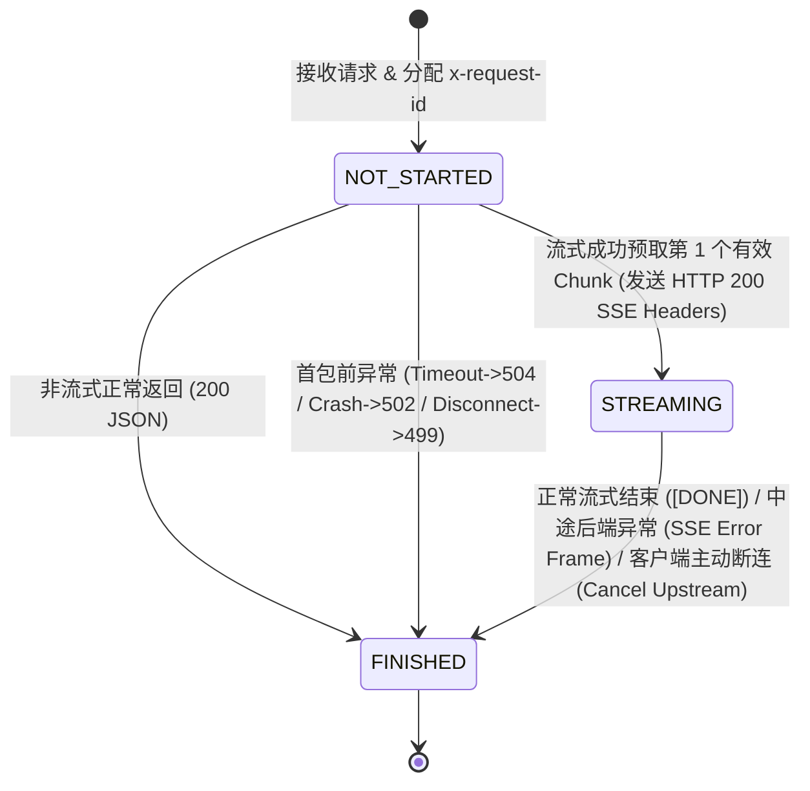
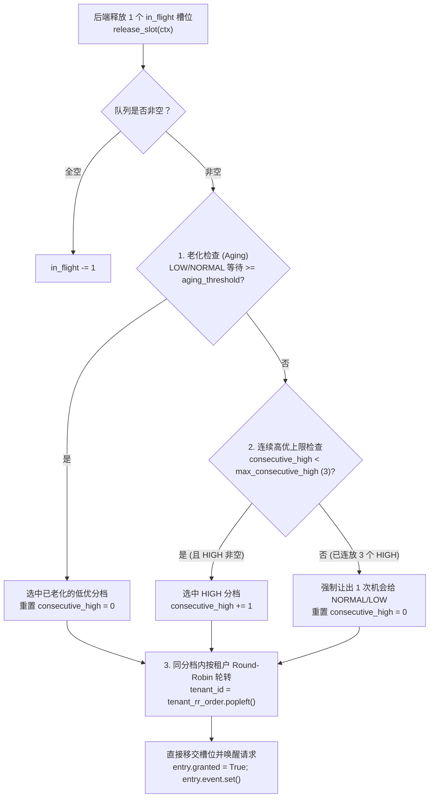

# 🌐 大模型服务网关设计与实测报告 (M1: Async Streaming Gateway & Admission Control)

> **对应里程碑**：Milestone 1 (M1) — 请求生命周期控制、异步流式透传、异常故障语义与准入过载保护  
> **核心代码目录**：[`gateway/`](../gateway/)（[`app.py`](../gateway/app.py)、[`admission.py`](../gateway/admission.py)、[`config.py`](../gateway/config.py)、[`models.py`](../gateway/models.py)）  
> **验证测试套件**：[`tests/test_gateway_step1.py`](../tests/test_gateway_step1.py)（Step 1 故障注入）、[`tests/test_gateway_real_vllm.py`](../tests/test_gateway_real_vllm.py)（真机 vLLM 端到端集成测试）、[`tests/test_gateway_step2.py`](../tests/test_gateway_step2.py)（Step 2 准入控制与公平性队列测试）  
> **实测落盘数据**：[`results/gateway/step1_failure_tests.json`](../results/gateway/step1_failure_tests.json)、[`results/gateway/step1_real_vllm_integration.json`](../results/gateway/step1_real_vllm_integration.json)、[`results/gateway/step2_admission_tests.json`](../results/gateway/step2_admission_tests.json)

---

## 目录

1. [为什么在 vLLM 前必须自建一层 HTTP Gateway？](#1-为什么在-vllm-前必须自建一层-http-gateway)
2. [M1 Step 1：最小异步流式转发与请求生命周期控制](#2-m1-step-1最小异步流式转发与请求生命周期控制)
   - [2.1 核心架构与三态状态机 (`NOT_STARTED` → `STREAMING` → `FINISHED`)](#21-核心架构与三态状态机-not_started--streaming--finished)
   - [2.2 关键工程实现细节](#22-关键工程实现细节)
   - [2.3 为什么发出 HTTP 200 Headers 后不能再改回 502 JSON？（首包预取设计）](#23-为什么发出-http-200-headers-后不能再改回-502-json首包预取设计)
   - [2.4 故障注入与边界测试实测报告 (`step1_failure_tests.json`)](#24-故障注入与边界测试实测报告-step1_failure_testsjson)
   - [2.5 真机 vLLM 端到端与断连回收实测报告 (`step1_real_vllm_integration.json`)](#25-真机-vllm-端到端与断连回收实测报告-step1_real_vllm_integrationjson)
3. [M1 Step 2：准入控制（Admission Control）、有界队列与过载反压](#3-m1-step-2准入控制admission-control有界队列与过载反压)
   - [3.1 核心设计思想（参考 llm-d EPP Flow Control 四大支柱）](#31-核心设计思想参考-llm-d-epp-flow-control-四大支柱)
   - [3.2 状态码反压语义严格分离（`429` vs `503` vs `504`）](#32-状态码反压语义严格分离429-vs-503-vs-504)
   - [3.3 优先级防饥饿与多租户 Round-Robin 公平调度算法](#33-优先级防饥饿与多租户-round-robin-公平调度算法)
   - [3.4 M1 Step 2 自动化压测与边界实测报告 (`step2_admission_tests.json`)](#34-m1-step-2-自动化压测与边界实测报告-step2_admission_testsjson)

---

## 1. 为什么在 vLLM 前必须自建一层 HTTP Gateway？

在 Milestone 0 (M0) 中，压测客户端直接请求单台 vLLM (`http://localhost:8000`) 以测出引擎裸机性能上限（Golden Baseline）。但在进入真实生产环境或多机路由前，**必须先在客户端与 vLLM 之间插入一层自研异步网关（Gateway）**：

1. **客户端断连即时止损（Disconnect Propagation & KV Block Reclamation）**：
   - 用户在网页端点击“停止生成”或网络断开时，若缺少网关层的 `request.is_disconnected()` 监听与 `upstream_resp.aclose()` 主动断流，后端 vLLM 仍可能继续空跑数百个 Decode Step，白白占用宝贵的 GPU 算力与 KV Cache 物理块。
2. **精细化四维超时与状态敏感错误处理（4D Timeouts & State-Aware Error Semantics）**：
   - LLM 推理具有独特的两阶段耗时特征：Prefill 阶段首字等待（TTFT）可能长达数秒，而 Decode 阶段相邻 Token 间隔（TPOT）仅数十毫秒。网关层通过 `httpx.Timeout(connect, read, write, pool)` 独立控制建连超时、流式单步读取超时与连接池等待超时。
3. **统一请求追踪与可观测性锚点（`x-request-id` & TTFT/E2E Attribution）**：
   - 网关为每个请求生成或透传全链路唯一的 `x-request-id`，并在网关侧精确记录 `ttft_ms`、`e2e_ms` 与生命周期终态，解耦客户端与后端引擎日志。
4. **控制变量法（为什么 Step 1 只连单台 vLLM，不做智能路由？）**：
   - 如果同时写网关转发与多节点路由，一旦出现 SSE 丢帧、连接池耗尽（`PoolTimeout`）或客户端断连后 GPU 仍在空跑，将无法定位是流式代理生命周期 Bug 还是路由算法 Bug。因此 **M1 Step 1 严格锁定单台 Backend**，把连接生命周期与异常语义验证到 100% 零泄漏。

---

## 2. M1 Step 1：最小异步流式转发与请求生命周期控制

### 2.1 核心架构与三态状态机 (`NOT_STARTED` → `STREAMING` → `FINISHED`)

在 [`gateway/models.py`](../gateway/models.py) 中，每一个进入网关的请求由 [`RequestContext`](../gateway/models.py#L22-L54) 追踪，并严格遵循单向三态状态机（[`RequestLifecycleState`](../gateway/models.py#L14-L19)）：



| 状态枚举 | 物理含义 | HTTP 响应头是否已发出？ | 发生异常时的合法处理方式 |
| :--- | :--- | :---: | :--- |
| **`NOT_STARTED`** | 请求刚进入网关，正在建连或等待后端返回第一个有效字节（Prefill 阶段） | **否** | 可干净地返回标准 HTTP 错误码与 JSON（超时 `504`、上游崩溃/拒绝 `502`、客户端提前断开 `499`） |
| **`STREAMING`** | 网关已收到后端第一个有效数据块，并向客户端发出了 `HTTP/1.1 200 OK` (`text/event-stream`) | **是（不可逆）** | **严禁再尝试修改 HTTP 状态码**；必须通过流内追加 `data: {"error": {"type": "mid_stream_error", ...}}\n\n` + `data: [DONE]\n\n` 通知客户端，并在 `finally` 中关闭上游连接 |
| **`FINISHED`** | 请求生命周期终结（正常完成、异常终止或客户端断连取消） | 已完成 | 幂等触发 `upstream_resp.aclose()` 归还/销毁连接，活跃计数器 `active_requests` 减 1 |

---

### 2.2 关键工程实现细节

1. **进程级 `httpx.AsyncClient` 连接池复用**（[`gateway/app.py`](../gateway/app.py#L64-L81)）：
   - 通过 FastAPI `lifespan` 上下文在进程启动时初始化全局唯一的 `httpx.AsyncClient`，配置 `httpx.Limits(max_connections=200, max_keepalive_connections=50, keepalive_expiry=30.0)`。
   - 严禁在每个请求函数内 `async with httpx.AsyncClient()` 创建临时客户端，彻底消除高并发下的 TCP 三次握手开销与临时端口耗尽风险。
2. **零缓冲逐块流式透传（Zero-Buffering SSE Passthrough）**（[`gateway/app.py`](../gateway/app.py#L227-L296)）：
   - 使用 `req = client.build_request(...)` + `upstream_resp = await client.send(req, stream=True)` 手动接管上游流生命周期（避免 `async with client.stream()` 在 `StreamingResponse` 返回瞬间提前关闭上游流）。
   - 使用 `upstream_resp.aiter_raw()` 按原始网络字节块逐块 `yield` 给客户端，**绝不在网关内存中拼接或缓存完整回答**，保证极低的内存水位与微秒级逐块转发延迟。
3. **双路客户端断连检测与上游即刻取消**：
   - 在每次 `yield` 前后检查 `await request.is_disconnected()`；同时当客户端主动关闭 socket 时，Starlette 底层 `listen_for_disconnect` 会取消消费协程并在生成器挂起点注入 `asyncio.CancelledError` / `GeneratorExit`。
   - 生成器 `finally:` 块确保**无论以何种路径退出（正常结束、客户端断连、后端中途崩溃、读取超时），必定执行 `await upstream_resp.aclose()`**，立刻触发向 vLLM 的 TCP 连接中断/关闭，让 vLLM 引擎终止该请求的后续 Decode 步。

---

### 2.3 为什么发出 HTTP 200 Headers 后不能再改回 502 JSON？（首包预取设计）

- **协议层原因**：在 HTTP/1.1 的分块传输（`Transfer-Encoding: chunked`）与 SSE 协议中，状态行（`HTTP/1.1 200 OK`）和响应头（`Content-Type: text/event-stream`）在第一个响应字节通过网卡发出前就已经写入 TCP 字节流。HTTP 协议没有“撤回已发送响应头”的机制。
- **首包预取（First-Chunk Pre-fetch）技巧**（[`gateway/app.py`](../gateway/app.py#L194-L225)）：
  - 如果后端已经发回了 HTTP 200 响应头，但在 Prefill 算第一个 Token 时发生 GPU OOM 崩溃或 `ReadTimeout`，普通的流式代理由于此时已经构造并返回了 `StreamingResponse`，会导致客户端收到 `200 OK` 空流。
  - 我们在进入 `StreamingResponse` **之前**（仍处于 `NOT_STARTED` 状态），先手动执行一次 `first_chunk = await anext(chunk_iter, b"")`。
  - **收益**：若后端在吐出第 1 个 Token 前超时或崩溃，异常会在 `NOT_STARTED` 阶段被捕获，网关直接向客户端返回干净的 **HTTP `504 Gateway Timeout` 或 `502 Bad Gateway` JSON**！只有当 `first_chunk` 真正到达网关后，才调用 `ctx.mark_streaming()` 切换至 `STREAMING` 状态并把 `first_chunk` 连同后续流交给 `StreamingResponse`。

---

### 2.4 故障注入与边界测试实测报告 (`step1_failure_tests.json`)

通过 [`tests/test_gateway_step1.py`](../tests/test_gateway_step1.py) 针对 6 类核心正常与故障注入场景进行自动化验证，运行命令：

```bash
python -m pytest tests/test_gateway_step1.py -v
```

**实测结果汇总（`6 passed in 0.96s`，完整数据见 [`results/gateway/step1_failure_tests.json`](../results/gateway/step1_failure_tests.json)）**：

| 测试场景 | 故障注入方式 | 生命周期状态变迁 | 实测观测结果 | 上游流关闭 (`upstream_closed`) | 泄漏请求数 (`leaked_active_requests`) |
| :--- | :--- | :--- | :--- | :---: | :---: |
| **1. 非流式正常转发** | `stream=false` 正常返回 JSON | `NOT_STARTED` → `FINISHED` | HTTP `200`，透传 `x-request-id` 与 `x-gateway-ttft-ms` | `true` | `0` |
| **2. 流式正常透传** | `stream=true` 连续发射 4 个 SSE 帧 | `NOT_STARTED` → `STREAMING` → `FINISHED` | HTTP `200`，完整收到 `hello` + ` world` + `[DONE]`（共 4 块） | `true` | `0` |
| **3. 首字前失败（Pre-First-Token）** | 后端在首字前超时 (`ReadTimeout`) 或发完 200 头后首包前崩溃 (`RemoteProtocolError`) | `NOT_STARTED` → `FINISHED` | 超时精准返回 **HTTP `504`** JSON；崩溃精准返回 **HTTP `502`** JSON | `true` | `0` |
| **4. 流式中途失败（Mid-Stream）** | 后端成功发出第 1 个 Token 后，在第 2 个 Token 处断流崩溃 | `NOT_STARTED` → `STREAMING` → `FINISHED` | 已承诺 **HTTP `200`** 不可更改；网关在流内优雅追加 `type: "mid_stream_error"` SSE 错误帧 + `[DONE]` | `true` | `0` |
| **5. 客户端收到若干 Token 后主动断开** | 后端计划生成 100 个 Token，客户端收到 **2 个 chunk** 后立刻发送 ASGI `http.disconnect` | `NOT_STARTED` → `STREAMING` → `FINISHED` | 后端实际仅生成 **2 个 chunk** 即被网关取消关闭（省去后续 98 个 Token 的空跑浪费） | `true` | `0` |
| **6. 慢客户端读取 + 25 并发压测** | **25 路并发流式请求**（含 **5 个慢客户端**每 chunk 延迟 `40ms`） | 全部归入 `FINISHED` | 快慢客户端互不阻塞，25 路全部完整收包，无连接池耗尽 | `true` | `0` |

---

### 2.5 真机 vLLM 端到端与断连回收实测报告 (`step1_real_vllm_integration.json`)

在本地 Docker 容器启动真实 vLLM (`vllm/vllm-openai:v0.25.1`，模型 `RedHatAI/Qwen2.5-7B-Instruct-FP8-dynamic`，RTX 5080 Laptop GPU)，通过 [`tests/test_gateway_real_vllm.py`](../tests/test_gateway_real_vllm.py) 进行端到端验证：

```bash
docker compose up -d vllm
python -m pytest tests/test_gateway_real_vllm.py -v
```

**真机实测结果（`1 passed in 2.02s`，完整数据见 [`results/gateway/step1_real_vllm_integration.json`](../results/gateway/step1_real_vllm_integration.json)）**：

| 验收维度 | 实测指标与表现 | 结论 |
| :--- | :--- | :---: |
| **后端模型发现 (`GET /v1/models`)** | 成功通过 Gateway 识别真实 vLLM 模型 `qwen2.5-7b-instruct-fp8` | ✅ PASS |
| **非流式端到端问答 (`stream=false`)** | HTTP `200`，端到端延迟 **`366.64 ms`**，回复 `"Hi there!"` | ✅ PASS |
| **流式 SSE 零丢帧校验 (`stream=true`)** | 首字延迟 **TTFT = `59.22 ms`**，连续接收 **34 个 SSE 数据帧** + `data: [DONE]`，逐帧 JSON 解析零损坏，完整还原 `"Sure! Here is the count from 1 to 10:\n\n1, 2, 3, 4, 5, 6, "` | ✅ PASS |
| **客户端断连 → 真实 vLLM 停止 Decode 验证** | 发起 `max_tokens=300` 长生成请求，客户端收到 **3 个 chunk** 后主动断开 ASGI 连接 → 网关触发 `upstream_resp.aclose()` → 轮询真实 vLLM `/metrics`，**`164.94 ms` 内 `vllm:num_requests_running` 彻底归零 (`0.0`)**，网关 `leaked_active_requests = 0` | ✅ PASS |

---

## 3. M1 Step 2：准入控制（Admission Control）、有界队列与过载反压

### 3.1 核心设计思想（参考 llm-d EPP Flow Control 四大支柱）

当外部到达流量超过后端 vLLM 的并发能力时，如果网关直接将所有请求透传进后端，会导致后端内部队列无限膨胀、高优请求队头阻塞，且在多实例路由（M2）下引发 **“调度悔恨（Scheduling Regret / 过早绑定）”**。

因此在 [`gateway/admission.py`](../gateway/admission.py) 中，我们实现了 [`AdmissionController`](../gateway/admission.py#L103-L459)，落地了 `llm-d EPP` 的四大核心流控机制：

1. **饱和检测与 Work-Conserving 直通（Saturation）**：
   - 默认配置 `max_inflight = 4`，`queue_capacity = 20`。
   - 当 `in_flight < max_inflight` 且队列为空时，请求 **0 排队延迟**直接获得执行槽位发往后端；仅当 `in_flight == max_inflight` 进入饱和态时才激活网关有界队列。
2. **逻辑流分类（Flow Classification）**：
   - 提取请求头 `X-Tenant-ID`（或请求体 `tenant_id`/`user`）与 `X-Priority`（`high` / `normal` / `low`），构建 `FlowKey = (tenant_id, priority)`。
3. **两级公平调度与防饥饿（Priority + Per-Tenant Fairness + Anti-Starvation）**：
   - **同优先级内（Per-Tenant Round-Robin）**：每个优先级分档内按租户维护独立 FIFO 子队列与轮转环（`tenant_rr_order`），每次出队在有积压的租户间交替轮转，彻底防止“吵闹邻居（Noisy Neighbor）”饿死其他租户。
   - **跨优先级间（Consecutive Cap + Aging 防永久饥饿）**：默认优先调度 `high`；但通过 `max_consecutive_high_priority = 3` 与 `starvation_aging_seconds` 保底：当连续放行 3 个 `high` 请求且低优队列非空时，**强制将第 4 个槽位让给等待中的 `normal` / `low` 请求**，从数学上保证低优先级请求绝不永久饥饿。
4. **排队与执行双态取消/超时清理（Direct Slot Handoff）**：
   - 排队期间实时监听 `request.is_disconnected()` 与 `queue_timeout` / `deadline`；一旦客户端在排队期间断开连接，立即从有界队列中摘除该节点，绝不浪费后续释放的后端槽位。
   - 当执行态请求完成、超时或断连时，在 `finally` 中幂等调用 `admission.release_slot(ctx)`，采用**槽位直接移交（Direct Handoff）**机制唤醒下一个排队请求，防止新到达请求插队（Barging）。

---

### 3.2 状态码反压语义严格分离（`429` vs `503` vs `504`）

| HTTP 状态码 | 错误类型 (`error.type`) | 触发条件与物理含义 | 响应头契约 |
| :---: | :--- | :--- | :--- |
| **`429 Too Many Requests`** | `rate_limit_exceeded` / `tenant_quota_exceeded` | **单租户违规**：该租户超过 Token Bucket 速率上限（`tenant_rate_limit_rps`）或单租户最大并发配额（`tenant_max_concurrency`），此时系统全局可能仍有空闲，不影响其他正常租户。 | `X-Request-ID`, `Retry-After` |
| **`503 Service Unavailable`** | `server_overloaded_queue_full` / `queue_timeout_exceeded` | **系统级过载反压**：后端 `in_flight == max_inflight` 已满，且网关有界队列已达上限（`queued == queue_capacity`），或请求在网关队列中等待超过 `queue_timeout`。 | `X-Request-ID`, `Retry-After` |
| **`504 Gateway Timeout`** | `deadline_exceeded` / `gateway_timeout` | **全链路截止时间或后端超时**：请求携带的 `X-Request-Deadline-Seconds` 在排队或执行阶段耗尽，或后端 vLLM 首字/生成超时。 | `X-Request-ID` |

---

### 3.3 优先级防饥饿与多租户 Round-Robin 公平调度算法



---

### 3.4 M1 Step 2 自动化压测与边界实测报告 (`step2_admission_tests.json`)

通过 [`tests/test_gateway_step2.py`](../tests/test_gateway_step2.py) 对照学习计划中的 5 大硬性验收场景进行测试：

```bash
python -m pytest tests/test_gateway_step1.py tests/test_gateway_step2.py -v
```

**实测结果汇总（`11 passed in 2.00s`，完整落盘数据见 [`results/gateway/step2_admission_tests.json`](../results/gateway/step2_admission_tests.json)）**：

| 测试编号与验收场景 | 设定参数 (`max_inflight=4, queue_capacity=20`) | 实测核心数据与证据 (`step2_admission_tests.json`) | 结论 |
| :--- | :--- | :--- | :---: |
| **1. 并发突发超 24 请求 + 队列有界与恢复**<br>(`test_1_burst_over_24_bounded_queue_and_recovery`) | 瞬间并发打入 **32 个请求**，Mock Backend 固定耗时 `40ms` | • 后端最大实测并发：`max_observed_backend_inflight = 4`（严守上限 4）<br>• 队列最大实测长度：`max_observed_queue_len = 20`（严守上限 20，绝不无限增长）<br>• **24 个成功 (`200 OK`)**，**8 个溢出当场返回 `503`**<br>• 洪峰结束后 `in_flight=0, queued=0`，补发恢复请求 `200 OK` (`queue_wait_ms=0.0`) | ✅ PASS |
| **2. 租户配额/速率限制 (`429`) + 多租户争抢公平性**<br>(`test_2_tenant_quota_rate_limit_429_and_fairness`) | • 租户配额 `2` / 速率桶突发 `2`<br>• `tenant-noisy` 狂塞 6 个排队后，`tenant-quiet` 发 2 个 | • 单租户超限精准返回 **`429`**，同时其他租户返回 **`200`**<br>• 排队出队序列实测为：`["tenant-noisy", "tenant-quiet", "tenant-noisy", "tenant-quiet", ...]`，安静租户无需排在吵闹租户 6 个请求之后 | ✅ PASS |
| **3. 高优持续涌入 + 低优防永久饥饿**<br>(`test_3_continuous_high_priority_flood_no_low_priority_starvation`) | 先入队 **3 个 `low`**，随后持续涌入 **9 个 `high`**（配置 `max_consecutive_high=3`） | • 实测 12 个排队请求的出队顺序：<br>`["high", "high", "high", "low", "high", "high", "high", "low", "high", "high", "high", "low"]`<br>• 高优成功插队享受 3:1 带宽，同时每 3 个 `high` 后必保底放行 1 个 `low`，**`low_priority_starved_count = 0`** | ✅ PASS |
| **4. 客户端在排队期间主动取消**<br>(`test_4_client_cancel_in_queue_evicts_cleanly_and_preserves_slots`) | 4 个请求占满槽位，第 5 个请求 (`req-cancel-in-queue`) 排队中途断开，第 6 个 (`req-survivor`) 排在后面 | • `cancelled_in_queue_count = 1`<br>• `cancelled_request_sent_to_backend = false`（绝不白送后端浪费算力）<br>• 槽位释放时直接唤醒第 6 个请求 `req-survivor` (`200 OK`)，最终 `in_flight=0, queued=0` | ✅ PASS |
| **5. 排队超时 (`503`)、全链路 Deadline (`504`) 与后台超时回收**<br>(`test_5_queue_timeout_deadline_and_backend_timeout_slot_recovery`) | `queue_timeout=40ms`，请求级 `X-Request-Deadline-Seconds: 0.02 / 0.04` | • 排队等槽位超时返回 **`503`** (`queue_timeout_exceeded`)<br>• 全链路 Deadline 在排队或执行态耗尽返回 **`504`** (`deadline_exceeded` / `gateway_timeout`)<br>• 超时后槽位 `100%` 回收 (`in_flight=0, queued=0`)，后续 4 个并发请求全部 `200 OK` | ✅ PASS |
