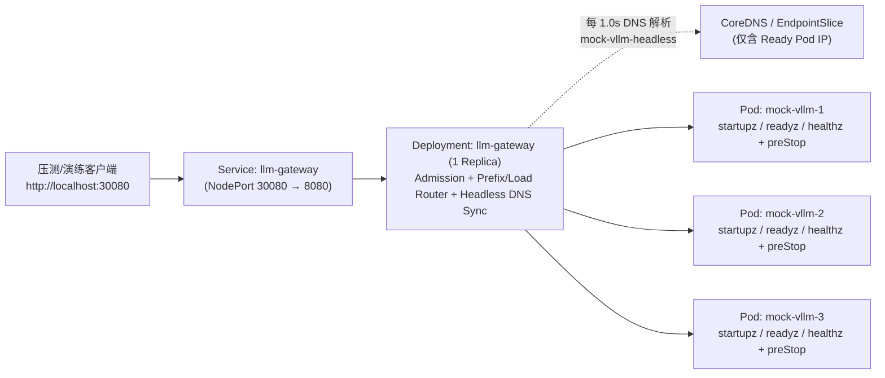

# Step 5｜Kubernetes 部署与 Replica 生命周期治理实战报告（M3）

> **目标**：把已完成准入控制、Prefix-Aware 路由与可观测性证据链的 **LLM Gateway + 3 Mock Replicas** 真正部署到本地 `kind` Kubernetes 集群中，打通 **Headless Service 动态服务发现 → 三探针职责分离 → 滚动更新零丢包优雅摘流（Graceful Drain） → 三大实时故障注入演练**，形成可复现的 Manifests 与实测证据链。
>
> **边界声明**：本报告中的 3 副本 `mock-vllm` 用于在无 GPU 的本地 `kind` 集群中验证 **Kubernetes 控制面生命周期、Endpoint 摘流与流式优雅下线机制**；Mock 吞吐/延迟不代表真实多 GPU 集群性能（真实单卡 RTX 5080 vLLM 推理与 SLO 基准见 [Step 4 证据链报告](slo_benchmark_regression_report.md)）。

---

## 1. 为什么先做 Headless Service + 三探针 + Graceful Drain？

将 LLM 推理集群放到 Kubernetes 上，与传统无状态 Web 微服务最大的三个区别在于：

1. **为什么不用普通 `ClusterIP` Service，而必须用 Headless Service (`clusterIP: None`)？**
   - 普通 `ClusterIP` Service 由 `kube-proxy` 在 L4 做随机/轮询负载均衡，会**直接摧毁 M2 Gateway 的 Prefix-Aware KV Cache 局部性**，且无法感知单 Pod 的 `inflight` 与 KV 压力。
   - **Headless Service (`clusterIP: None`)** 在 CoreDNS 中直接返回所有 `Ready` 后端 Pod 的真实 IP 列表。Gateway 内的 [`HeadlessDNSReplicaDiscoverer`](../gateway/discovery.py) 每 1.0s 解析一次 `mock-vllm-headless.llm-serving.svc.cluster.local`，自动将新 Ready 的 Pod IP 注册进 `ReplicaRegistry`，并在 Pod 消失（未就绪/被杀/下线中）时**第一时间标为不可调度（停止分配新请求）**，待既有 SSE 流全部吐完 `[DONE]`（`inflight == 0`）后再摘除实例并清理其过期前缀缓存索引。
2. **为什么三探针（Startup / Readiness / Liveness）绝不能混用？**
   - **`startupProbe` (`/startupz`)**：兜底大模型权重加载与 CUDA Graph 捕获（可能长达 10s~数分钟）。在它成功前，`livenessProbe` 和 `readinessProbe` 全部挂起，杜绝冷启动被误杀引发 `CrashLoopBackOff`。
   - **`readinessProbe` (`/readyz`)**：**只摘流、绝不重启容器**。当模型未加载完成、Pod 进入 `preStop` 排空期、或手动/过载标为不就绪时返回 `503`，Kubernetes 将其 IP 从 `Endpoints/EndpointSlice` 与 CoreDNS 移除，保护该 Pod 上正在跑的长流式推理与珍贵的冷/热 KV Cache。
   - **`livenessProbe` (`/healthz`)**：**轻量进程存活探针，绝对不耦合推理队列深度或计算延迟**。高并发满载导致的尾延迟升高是**容量问题（应由 Gateway 准入控制限流 + Readiness 摘流/扩缩容解决）**，若绑进 Liveness 会触发 Kubelet 反复 `SIGKILL` 重启进程——不仅瞬间打断所有 SSE 长流，还会清空显存 KV Cache、迫使 Pod 进入漫长冷启动，导致存活副本雪崩级联宕机。
3. **为什么需要“两阶段 `preStop` + 原生 `SIGTERM` Graceful Drain”？**
   - Kubernetes 删除 Pod 时，**EndpointSlice/CoreDNS 摘除与 Kubelet 终止容器是两条异步并行链路**。如果应用刚进入 `preStop` 就立刻对业务请求返回 `503`，在 DNS 缓存与 Gateway 1s 轮询尚未同步的 ~0.1–1.0s 窗口内，新抵达的“在途请求”就会报错 `503`。
   - 我们在实测演练中亲历并修复了这一经典竞态（见第 4.2 节 Before/After 实测记录）：
     - **Phase 1 (`preStop` 传播宽限期)**：调用 `POST /admin/drain?reject_new=false`，`/readyz` 立刻返回 `503` 触发 Endpoints/DNS 摘流，同时在 `sleep 4` 宽限期内继续兜底服务 DNS 尚未收敛前抵达的尾单；
     - **Phase 2 (`preStop` 硬拒新 + 原生 Uvicorn `SIGTERM`)**：4s 后调用 `POST /admin/drain?reject_new=true`（拒绝新请求），随后 `preStop` 退出，Kubelet 发送 `SIGTERM` 给 PID 1（Uvicorn `--timeout-graceful-shutdown 35`），Uvicorn 停止接收新 TCP 连接，等待所有既有 SSE 长流优雅吐完 `data: [DONE]` 后以退出码 `0` 干净退出（全流程严格控制在 `terminationGracePeriodSeconds: 45` 内）。

---

## 2. 集群拓扑与可运行 Manifests 交付清单



| 交付文件 | 作用与核心配置 |
| :--- | :--- |
| [`k8s/kind-config.yaml`](../k8s/kind-config.yaml) | 本地单节点 `kind` 集群配置，将宿主 `localhost:30080` 映射至节点 `NodePort 30080` |
| [`k8s/namespace.yaml`](../k8s/namespace.yaml) | 独立命名空间 `llm-serving` |
| [`k8s/configmap.yaml`](../k8s/configmap.yaml) | Gateway 运行参数（`GATEWAY_ROUTING_POLICY=cache+load-aware`、`GATEWAY_K8S_HEADLESS_SERVICE`、1.0s DNS 同步周期、限流与熔断阈值） |
| [`k8s/mock-vllm.yaml`](../k8s/mock-vllm.yaml) | Headless Service (`clusterIP: None`) + 3 副本 Deployment (`maxUnavailable: 0, maxSurge: 1`、三探针、`resources`、两阶段 `preStop`、`terminationGracePeriodSeconds: 45`) |
| [`k8s/gateway.yaml`](../k8s/gateway.yaml) | Gateway NodePort Service (`30080`) + Deployment（Readiness 联动可用后端副本数、Liveness 独立保活、`preStop` 排空） |
| [`mock_backend/server.py`](../mock_backend/server.py) | 容器化 Mock vLLM Replica：支持 `STARTUP_DELAY_SEC` 冷启动、三探针端点、`/admin/drain` 两阶段排空、`/admin/readiness` 摘流注入、SSE 流式与 `/metrics` |
| [`gateway/discovery.py`](../gateway/discovery.py) | Gateway Kubernetes Headless DNS 动态发现与 `inflight==0` 延迟摘除器 |
| [`Dockerfile.gateway`](../Dockerfile.gateway) & [`Dockerfile.mock_backend`](../Dockerfile.mock_backend) | 轻量 Python 3.10 容器镜像（`--timeout-graceful-shutdown` 原生支持 `SIGTERM` 流式排空） |
| [`scripts/run_k8s_fault_drills.py`](../scripts/run_k8s_fault_drills.py) | 自动化 3 大故障注入与证据采集脚本（输出 `results/k8s/*.json`） |
| [`tests/test_k8s_lifecycle.py`](../tests/test_k8s_lifecycle.py) | 单元测试：验证三探针冷启动、两阶段排空、Headless DNS 动态增删与 0 副本 Readiness 降级 |

---

## 3. 一键本地部署与版本滚动更新命令

```bash
# 1. 创建本地 kind 集群（暴露 localhost:30080）
kind create cluster --config k8s/kind-config.yaml

# 2. 构建并装载 Gateway 与 Mock Replica 镜像到 kind 节点
docker build -f Dockerfile.gateway -t vllm-serving-lab/gateway:local .
docker build -f Dockerfile.mock_backend -t vllm-serving-lab/mock-vllm:local .
kind load docker-image vllm-serving-lab/gateway:local --name llm-serving
kind load docker-image vllm-serving-lab/mock-vllm:local --name llm-serving

# 3. 部署所有 Kubernetes 资源并观察就绪状态
kubectl apply -f k8s/namespace.yaml
kubectl apply -f k8s/configmap.yaml
kubectl apply -f k8s/mock-vllm.yaml
kubectl apply -f k8s/gateway.yaml
kubectl -n llm-serving rollout status deployment/mock-vllm --timeout=120s
kubectl -n llm-serving rollout status deployment/llm-gateway --timeout=120s
kubectl -n llm-serving get pods,svc,endpoints -o wide

# 4. 手动触发滚动更新 / 重启并观察版本切换
kubectl -n llm-serving set env deployment/mock-vllm APP_VERSION=v2
kubectl -n llm-serving rollout status deployment/mock-vllm
# 或原地滚动重启：
kubectl -n llm-serving rollout restart deployment/mock-vllm
kubectl -n llm-serving rollout status deployment/mock-vllm

# 5. 一键运行全部 3 项实时故障注入演练并保存 JSON 证据
python scripts/run_k8s_fault_drills.py
```

---

## 4. 三大实时故障注入演练记录（Live `kind` 实测证据）

所有数据均采集自真实本地 `kind` 集群（`kind v0.27.0`，命名空间 `llm-serving`，1 Gateway + 3 Mock Replicas，实时并发 SSE 流式请求），原始 JSON 日志完整落盘于 [`results/k8s/`](../results/k8s/)。

### 演练总览汇总（[`results/k8s/summary.json`](../results/k8s/summary.json)）

| 故障演练 | 注入操作 | 请求成功率 | 恢复 / 发布耗时 | 关键生命周期验证结论 |
| :--- | :--- | :---: | :---: | :--- |
| **Drill 1: 强杀后端 Pod** | `kubectl delete pod --grace-period=0 --force` | **41/41 (100.0%)**<br/>恢复后 **13/13 (100.0%)** | Endpoints 摘除 **0.67s**<br/>新副本 Ready 恢复 **6.56s** | Deployment 自动拉起新 Pod，Gateway DNS 同步自动摘除死亡 IP 并接管新 IP |
| **Drill 2: 滚动更新 (`v1 → v2`)** | `kubectl set env APP_VERSION=v2` + `rollout status` | **88/88 (100.0%)**<br/>(`v1`: 79, `v2`: 9, **0 断流**) | **19.62s**（`maxUnavailable=0, maxSurge=1`） | 两阶段 `preStop` + Uvicorn 原生 `SIGTERM` 实现**零丢包滚动发布**与平滑版本切换 |
| **Drill 3A: 12s 模型冷启动** | `STARTUP_DELAY_SEC=12.0` 滚动更新 | 期间恒定保持 **3 个 Ready Endpoints** | **45.94s**（3 副本依次冷启动） | `startupProbe` 屏蔽冷启动期，`max_pod_restarts = 0`，加载中 Pod 不接流量 |
| **Drill 3B: Readiness 摘流隔离** | `POST /admin/readiness {"ready": false}` → `true` | 隔离期 **12/12 (100.0%)**<br/>命中异常 Pod **0 次** | Endpoints 摘除 **3.08s**<br/>恢复回流 **1.55s** | **只摘流、不重启**（`restarts: 0 → 0`），恢复后自动重新加入 Endpoints 与 Gateway |

---

### 4.1 演练一：强杀后端 Pod（[`results/k8s/drill1_kill_backend.json`](../results/k8s/drill1_kill_backend.json)）

- **场景**：以每 `0.25s` 发送 1 条 10-token SSE 流式请求的持续流量打向 Gateway，随后对 `mock-vllm-849c779987-5dll2` (`10.244.0.10`) 执行强制立刻销毁（`--grace-period=0 --force`）。
- **Endpoint 变化时间线**：
  - `t = 0.00s`（初始稳态）：`['10.244.0.10', '10.244.0.11', '10.244.0.12']`
  - `t = 0.67s`（强杀后摘除）：`['10.244.0.11', '10.244.0.12']`（`10.244.0.10` 被控制面迅速剔除）
  - `t = 6.56s`（副本自愈恢复）：`['10.244.0.11', '10.244.0.12', '10.244.0.13']`（ReplicaSet 补建的新 Pod 通过 `startupProbe` + `readinessProbe` 自动上线）
- **Gateway 动态发现日志节选**：
  ```json
  {"timestamp": 1795494166.475, "ready_ips": ["10.244.0.11", "10.244.0.12"], "marked_unready": ["pod-10-244-0-10"], "unregistered": ["pod-10-244-0-10"]}
  {"timestamp": 1795494172.493, "ready_ips": ["10.244.0.11", "10.244.0.12", "10.244.0.13"], "added": ["pod-10-244-0-13"]}
  ```
- **结果分析**：因为 Prefix-Aware 路由将共享系统提示词亲和在健康副本 `10.244.0.12` 上且强杀摘流仅耗时 `0.67s`，演练全程 **41/41 (100.0%) 成功**，恢复后稳态验证 **13/13 (100.0%) 成功**。

---

### 4.2 演练二：滚动更新期间持续流式流量（[`results/k8s/drill2_rolling_update.json`](../results/k8s/drill2_rolling_update.json)）

#### 💡 真实工程排查：一次由 96.67% 迭代到 100.0% 零丢包的 Before / After 闭环

在首轮真实集群演练中，我们发现了两个在单机单元测试里极难暴露、但在真实 Kubernetes 中必现的生命周期缺陷：

| 版本迭代 | 问题现象（指标/状态证据） | 根因定位 | 代码与 Manifest 修复 | 对照结果 |
| :--- | :--- | :--- | :--- | :--- |
| **Iteration 1（初版单阶段 `preStop`）** | 1) `87/90 (96.67%)`，出现 **3 次前置 HTTP `503`**（无断流 `mid_stream_error=false`）<br/>2) 旧 Pod 在退出阶段悬挂长达 **45s** 才消失 | 1) `preStop` 立刻把业务请求标为 `503`，而 CoreDNS → Gateway 1s DNS 轮询存在 `0.13s–0.36s` 异步传播窗口，3 条在途请求撞上排空中的旧 Pod 报错 `503`；<br/>2) `lifespan` 中调用 `loop.add_signal_handler(SIGTERM, ...)` **覆盖了 Uvicorn 原生 `SIGTERM` 退出处理器**，导致容器无视 `SIGTERM` 直到 45s `SIGKILL`！ | 1) `preStop` 升级为**两阶段排空**：先 `reject_new=false` 立刻让 `/readyz→503` 摘流并在 `sleep 4` 窗口继续承接在途尾单，4s 后再 `reject_new=true`；<br/>2) 移除对 `SIGTERM` 的覆盖，让 Uvicorn 原生 `--timeout-graceful-shutdown 35` 优雅排空 SSE 流后 `exit 0` | **88/88 (100.0%) 零丢包、0 断流**；旧 Pod 在流结束后立刻干净退出，彻底消除 45s 悬挂！ |

#### Iteration 2 实测细节（[`drill2_rolling_update.json`](../results/k8s/drill2_rolling_update.json)）

- **`kubectl rollout status` 真实输出**：
  ```text
  Waiting for deployment "mock-vllm" rollout to finish: 1 out of 3 new replicas have been updated...
  Waiting for deployment "mock-vllm" rollout to finish: 2 out of 3 new replicas have been updated...
  Waiting for deployment "mock-vllm" rollout to finish: 1 old replicas are pending termination...
  deployment "mock-vllm" successfully rolled out
  ```
- **Endpoint 滚动演进（`maxUnavailable=0, maxSurge=1`，全程保持 ≥3 个 Ready 副本）**：
  - `t = 0.00s`：`['10.244.0.11', '10.244.0.12', '10.244.0.13']`（全 `v1`）
  - `t = 7.36s`：`['10.244.0.11', '10.244.0.12', '10.244.0.14']`（`10.244.0.14` 上线，`10.244.0.13` 摘除）
  - `t = 13.50s`：`['10.244.0.12', '10.244.0.14', '10.244.0.15']`（`10.244.0.15` 上线，`10.244.0.11` 摘除）
  - `t = 19.62s`：`['10.244.0.14', '10.244.0.15', '10.244.0.16']`（全 `v2`）
- **流式排空（Drain）实证证据**：看下面这两条紧邻 1 秒的 Gateway Discovery 事件——当 `pod-10-244-0-12` 在 `1795494196.57` 从 DNS 消失时，它上面仍有未完成的 SSE 流，因此 Gateway **立即将其标为 `marked_unready`（停止分配新请求）但暂不销毁（`unregistered: []`）**；1 秒后在途 SSE 流吐完 `[DONE]`，`inflight` 归零，Gateway 才在 `1795494197.573` 正式执行 `unregistered` 并释放其前缀索引：
  ```json
  {"timestamp": 1795494196.57,  "added": ["pod-10-244-0-16"], "marked_unready": ["pod-10-244-0-12"], "unregistered": []}
  {"timestamp": 1795494197.573, "added": [],                  "marked_unready": [],                  "unregistered": ["pod-10-244-0-12"]}
  ```
- **流量与版本切换结果**：总计 **88/88 (100.0% 成功)**，其中 `v1` 处理 79 条、`v2` 平滑接管后续 9 条，Trace 日志明确显示 `backend_request_id: chatcmpl-mock-vllm-5bd97749b-98979-v2-...`，**0 次错误、0 次中途断流**。

---

### 4.3 演练三：模型冷启动 (`startupProbe`) 与不就绪隔离 (`readinessProbe`)（[`results/k8s/drill3_cold_start_and_readiness.json`](../results/k8s/drill3_cold_start_and_readiness.json)）

#### Part 3A：模拟 12s 模型权重冷启动
- **操作**：`kubectl set env deployment/mock-vllm STARTUP_DELAY_SEC=12.0`，此时冷启动耗时（12s）接近甚至超过无 `startupProbe` 时激进 Liveness 的容忍时间。
- **实测结果**：
  - 滚动升级总耗时 **`45.94s`**；
  - 采样日志清晰观测到 `mock-vllm-5654c864d6-5pxjx`（`t=2.34s ~ 13.83s`）和 `mock-vllm-5654c864d6-bkjcb`（`t=16.11s ~ 18.38s`）均处于 `loading_unready_pods` 状态，在此期间 `ready_endpoints_count` 始终维持在 **`3`**（旧副本继续服务，未加载完的新副本绝不接流量）；
  - 全程 **`max_pod_restarts_during_12s_cold_start = 0`**，证明 `startupProbe` 完美屏蔽了冷启动期的 Liveness 误杀。

#### Part 3B：手动触发 1 个活跃副本不就绪 → 验证“只摘流、不重启、可自动恢复”
- **操作**：选中活跃 Ready 副本 `mock-vllm-5654c864d6-4vqdx` (`10.244.0.19`)，通过容器内 `POST /admin/readiness {"ready": false}` 模拟副本进入过载/异常摘流态（`/readyz` 返回 `503`，而 `/healthz` 保持 `200`）。
- **实测结果**：
  - **Endpoints 摘除**：初始 `['10.244.0.17', '10.244.0.18', '10.244.0.19']` → 仅 **`3.08s`** 后变为 `['10.244.0.17', '10.244.0.18']`（`periodSeconds: 2 × failureThreshold: 2`）；
  - **隔离期流量验证**：连续发送 12 条 SSE 请求，**12/12 (100.0%) 全部成功**，路由到 `mock-vllm-5654c864d6-4vqdx` 的次数为 **`0`**；
  - **零重启证明**：`container_restarts_before = 0`、`container_restarts_while_unready = 0`（`readiness_never_restarted_container: true`）；
  - **自动回流验证**：执行 `POST /admin/readiness {"ready": true}` 后，仅 **`1.55s`** 即恢复为 3 个 Ready Endpoints (`['10.244.0.17', '10.244.0.18', '10.244.0.19']`)，Gateway Discovery 日志同步打印 `'added': ['pod-10-244-0-19']`。

---

## 5. 核心概念通关自检（Readiness vs Liveness 与防重启雪崩）

| 维度 | `startupProbe` | `readinessProbe` | `livenessProbe` |
| :--- | :--- | :--- | :--- |
| **判定问题** | 模型权重 / CUDA Graph 是否加载完毕？ | 当前 Pod 是否适合继续承接**新流量**？ | 进程是否彻底死锁 / 崩溃无法自愈？ |
| **失败动作** | 挂起 Liveness/Readiness；超时则重启 | **从 Endpoints/DNS 摘除（摘流），绝不重启容器** | **Kubelet `SIGKILL` 重启容器** |
| **对 LLM 的意义** | 防止 10s~数分钟冷启动陷入 `CrashLoopBackOff` | 保护在途 SSE 长流、优雅下线、过载临时摘流保住 KV Cache | 仅兜底真正的进程僵死 / 事件循环彻底卡死 |
| **常见反模式** | 用固定 `initialDelaySeconds` 硬猜冷启动时间 | 不配 Readiness 导致启动未完就放流量 | **把“满载排队高延迟”或“真实推理请求”绑进 Liveness** |

> **为什么绝不应把满载造成的延迟直接当死锁并触发反复重启？**
> 满载高延迟的根因是**请求供给超过算力/KV 显存容量**。如果 Liveness 探针因队列排队超时而杀死 Pod，会立刻触发三重灾难放大效应：
> 1. **直接打断正在生成的 SSE 长流**，将可恢复的高延迟变成不可逆的客户端报错；
> 2. **瞬间蒸发整张 GPU 上已热身的 KV Cache / Prefix Cache**，重启后所有请求被迫重算 Prefill；
> 3. **新 Pod 进入数分钟冷启动加载权重**，期间所有流量涌向剩余存活副本，使存活副本更快超载、更快触发 Liveness 超时重启，最终演变为**整个推理集群的级联重启雪崩（Cascading Restart Storm）**。
>
> 正确的分层治理是：**Gateway 准入控制 + 有界队列 + 429/503 快速拒流**（入口防过载） + **`readinessProbe` 摘流**（节点减压而不丢 KV） + **HPA 扩容**（补足算力），Liveness 永远只做不依赖推理队列的轻量存活探测。

*(更多原理推导见 [`QA.md`](../QA.md) Q11。)*
