# Step 6｜Queue-Driven Autoscaling 自动控制闭环实战报告（M3）

> **目标**：把 Step 4 暴露的真实网关排队指标（`gateway_queue_depth`）与 Step 5 部署在 Kubernetes 上的 `mock-vllm` Deployment 打通，构建 **`Gateway (/metrics) → Prometheus → KEDA ScaledObject → HPA → Deployment → Headless DNS → Gateway 动态并发容量`** 完整自动控制闭环，并通过 4 项本地 `kind` 集群实机实验定量验证 **固定 vs 弹性副本对照、缩容稳定窗防抖、慢冷启动控制滞后、以及 Prometheus 断连 `fallback` 降级保护**。
>
> **实验边界声明**：本报告在本地 `kind`（`v0.27.0`）+ `KEDA v2.21.1` + `Prometheus v2.55.1` 集群中使用容器化 `mock-vllm` 验证 **Kubernetes 控制面的队列驱动弹性、防抖与容错机制**，**不代表真实多 GPU 推理吞吐的线性伸缩收益**（单卡 RTX 5080 真实 vLLM SLO 与回归门禁见 [Step 4 证据链报告](slo_benchmark_regression_report.md)）。

---

## 1. 端到端自动控制闭环架构与关键设计

```mermaid
flowchart LR
    Burst["突发流式流量<br/>3.33 req/s SSE Burst"] --> GW["llm-gateway (NodePort 30080)<br/>有界队列 gateway_queue_depth<br/>动态并发上限 effective_max_inflight"]
    GW -- "/metrics (2s scrape)" --> Prom["Prometheus v2.55.1<br/>max_over_time(gateway_queue_depth[30s])"]
    Prom -- "pollingInterval: 5s" --> KEDA["KEDA v2.21.1<br/>ScaledObject + Metrics Server"]
    KEDA -- "external.metrics.k8s.io<br/>AverageValue (threshold=2)" --> HPA["K8s HPA<br/>scaleUp: +2/15s<br/>scaleDown: 45s稳定窗, -1/15s"]
    HPA -- "修改 spec.replicas (1↔4)" --> Dep["Deployment: mock-vllm<br/>startupProbe + readinessProbe + preStop"]
    Dep -- "Ready Pod IPs" --> DNS["Headless Service DNS<br/>mock-vllm-headless"]
    DNS -. "1s 同步 + 唤醒等待队列" .-> GW
```



### 三个必须明确的架构细节

1. **队列归属权：`gateway_queue_depth` 属于 Gateway，而非 vLLM Engine Scheduler**：
   - 本闭环驱动扩容的指标是 Gateway 入口准入层的有界等待队列 `gateway_queue_depth`（由 [`gateway/admission.py`](../gateway/admission.py) 统计、[`gateway/metrics.py`](../gateway/metrics.py) 暴露），而不是后端单个引擎内部的 `vllm:num_requests_waiting`。
   - 必须同步打通 **Gateway 动态并发上限联动**（`GATEWAY_DYNAMIC_MAX_INFLIGHT=true`）：当 KEDA 扩容出新副本并通过 [`HeadlessDNSReplicaDiscoverer`](../gateway/discovery.py) 进入 Ready 列表后，Gateway 自动将 `effective_max_inflight` 从 `ready_replicas × per_replica_max_inflight`（`2 → 6 → 8`）实时放大，并**立即唤醒排队中的等待请求**（`gateway_effective_max_inflight` 同步暴露于 `/metrics`）。否则后端即使扩到 4 副本，请求依然会卡死在 Gateway 静态 `max_inflight` 门外！
2. **KEDA 与 HPA 的分工**：
   - `KEDA Operator` 根据 [`k8s/keda-scaledobject.yaml`](../k8s/keda-scaledobject.yaml) 自动创建并托管 `HPA/keda-hpa-mock-vllm-queue-scaler`；
   - `KEDA Metrics Server` 查询 Prometheus 并通过 `AverageValue`（$\text{desiredReplicas} = \lceil \text{metricValue} / 2 \rceil$）向 HPA 暴露外部指标；
   - `1 ↔ 4` 副本间的非对称扩缩容限速与缩容防抖由 **HPA `behavior`** 执行（`scaleUp` 限速每次最多 +2 Pod/15s 防冷启动过冲；`scaleDown.stabilizationWindowSeconds: 45` + 每次最多 -1 Pod/15s 防抖动，而 `cooldownPeriod` 仅在 `minReplicaCount: 0` 缩零时生效）。
3. **指标链路故障保护（Fail-Safe `fallback`）**：
   - 配置 `fallback: { failureThreshold: 2, replicas: 2 }` 与 `ignoreNullValues: "false"`，确保 Prometheus 短暂宕机或抓取缺失时，KEDA 将集群保守稳定在 2 副本而非误判为 0 负载缩容。

---

## 2. 交付清单与一键复现命令

| 交付文件 | 说明 |
| :--- | :--- |
| [`k8s/keda-scaledobject.yaml`](../k8s/keda-scaledobject.yaml) | KEDA `ScaledObject`（Prometheus Scaler、`AverageValue`、`min=1, max=4`、`scaleUp/scaleDown behavior`、`fallback`） |
| [`k8s/prometheus.yaml`](../k8s/prometheus.yaml) | 集群内 Prometheus (`v2.55.1`) Deployment + ConfigMap（2s 抓取 `llm-gateway:8080/metrics`）+ Service |
| [`k8s/configmap.yaml`](../k8s/configmap.yaml) | Gateway 动态容量配置（`GATEWAY_DYNAMIC_MAX_INFLIGHT="true"`, `GATEWAY_PER_REPLICA_MAX_INFLIGHT="2"`, `GATEWAY_MAX_INFLIGHT="16"`, `GATEWAY_QUEUE_CAPACITY="16"`） |
| [`gateway/admission.py`](../gateway/admission.py) & [`gateway/discovery.py`](../gateway/discovery.py) | `set_effective_max_inflight()` 动态槽位伸缩与 Headless DNS 副本变化联动唤醒 |
| [`tests/test_keda_autoscaling.py`](../tests/test_keda_autoscaling.py) | 单元测试：验证 K8s 副本 `1 → 2 → 1` 时 `effective_max_inflight` 动态扩缩与队列即时排空 |
| [`scripts/run_keda_autoscaling_experiments.py`](../scripts/run_keda_autoscaling_experiments.py) | 自动化 4 项实机 KEDA 扩缩容对照与边界实验脚本（输出 [`results/k8s_autoscaling/`](../results/k8s_autoscaling/)） |

```bash
# 1. 安装官方 KEDA v2.21.1 到本地 kind 集群
kubectl apply --server-side -f https://github.com/kedacore/keda/releases/download/v2.21.1/keda-2.21.1.yaml
kubectl -n keda rollout status deployment/keda-operator --timeout=180s
kubectl -n keda rollout status deployment/keda-metrics-apiserver --timeout=180s

# 2. 部署 Gateway、Mock Replicas、Prometheus 与 KEDA ScaledObject
kubectl apply -f k8s/namespace.yaml -f k8s/configmap.yaml -f k8s/mock-vllm.yaml -f k8s/gateway.yaml -f k8s/prometheus.yaml
kubectl apply -f k8s/keda-scaledobject.yaml

# 3. 实时观测 KEDA / HPA / Deployment 状态变化
kubectl -n llm-serving get scaledobject,hpa,deployment -w

# 4. 一键重放 4 项实机扩缩容对照与异常实验
python scripts/run_keda_autoscaling_experiments.py
```

---

## 3. 实机实验结果与定量对照（[`results/k8s_autoscaling/summary.json`](../results/k8s_autoscaling/summary.json)）

### 3.1 实验一 & 二：固定 1 副本 vs KEDA 弹性扩容（`1 → 4`）同 Burst 负载对照

**固定控制变量 Workload**：持续 `55s` 恒定突发流式请求，到达率 `3.33 req/s`（每 `0.30s` 发 1 条 `max_tokens=24, token_delay_ms=55ms` 的 SSE 请求，单请求服务耗时约 `1.35s`，共 `182~183` 条请求）。单副本处理上限仅约 `1.48 req/s`（2 槽），4 副本处理上限约 `5.93 req/s`（8 槽）。

*(注：流式请求测得的客户端 `TTFT` = Gateway 排队耗时 + Mock Prefill 约 `12~45ms`，因此高并发下的 `TTFT` 数值几乎纯粹反映排队等待延迟。)*

| 核心指标 | 固定 1 副本 Baseline ([`exp1`](../results/k8s_autoscaling/exp1_fixed_replica_burst.json)) | KEDA 弹性扩容 `1 → 4` ([`exp2`](../results/k8s_autoscaling/exp2_autoscaled_burst_and_stabilization.json)) | 变化幅度与工程解读 |
| :--- | :---: | :---: | :--- |
| **峰值 Ready 副本 / 并发上限** | `1` Pod (`eff_cap = 2`) | **`4` Pods (`eff_cap = 8`)** | `t=14.31s` HPA 首次决策扩至 3，`t=19.86s` 新 Pod Ready |
| **`gateway_queue_depth` 均值 / 峰值** | `12.87` / `16` | **`4.95` / `16`** | **均值降 `-61.5%`**；`t=30.89s` 起排队彻底归零（峰值同为 `16` 印证初期控制滞后不可避免） |
| **全程 (`0–55s`) HTTP 503 拒绝率** | **`46.15%`** (`84/182`) | **`9.29%`** (`17/183`) | **拒绝率相对下降 `-79.9%`**；全部 17 次 503 均发生在前 20s 扩容滞后期 |
| **初期滞后窗 (`0–20s`) 503 拒绝率** | `30.30%` (`20/66`) | **`25.76%`** (`17/66`) | **实证铁证：扩容绝不能“立刻”消除初始突发排队！** |
| **扩容后稳态窗 (`20–55s`) 503 拒绝率** | **`55.17%`** (`64/116`) | **`0.00%`** (`0/117`) | 扩容就绪后实现 **100.0% 零拒绝承接** |
| **全程 (`0–55s`) TTFT P50 / E2E P50** | `9,064.9 ms` / `10,358.7 ms` | **`62.3 ms` / `1,359.5 ms`** | **TTFT P50 降 `-99.3%`**，**E2E P50 降 `-86.9%`** |
| **全程 (`0–55s`) E2E P99** | `11,388.2 ms` | `10,909.9 ms` | **深刻洞察**：全程 P99 仍高达 ~10.9s，因为最慢的 1% 请求来自前 20s 滞后尖峰！ |
| **扩容后稳态窗 (`20–55s`) TTFT P99 / E2E P99** | `10,046.0 ms` / `11,349.8 ms` | **`2,444.0 ms` / `3,736.2 ms`** | 扩容生效后，**稳态 TTFT P99 降 `-75.7%`、E2E P99 降 `-67.1%`** |

#### 扩容与缩容全生命周期时间线（[`exp2_autoscaled_burst_and_stabilization.json`](../results/k8s_autoscaling/exp2_autoscaled_burst_and_stabilization.json)）

| 阶段 | 时间点 | `gateway_queue_depth` | `prom_max_queue_30s` | `spec / ready` 副本 | Gateway `eff_max_inflight` | 状态说明 |
| :--- | :---: | :---: | :---: | :---: | :---: | :--- |
| 初始稳态 | `t = 0.00s` | `0` | `0.0` | `1 / 1` | `2` | 突发流量开始 |
| 控制滞后期 | `t = 8.55s` | **`16`** | `13.0` | `1 / 1` | `2` | 队列打满并出现初期 503，等待 KEDA/HPA 同步 |
| HPA 首次扩容 | `t = 14.31s` | `15` | `16.0` | **`3 / 1`** | `2` | `scaleUp.policies (+2/15s)` 生效，2 个新 Pod 启动中 |
| 新副本上线消峰 | `t = 19.86s` | `10` | `16.0` | **`3 / 3`** | **`6`** | Headless DNS 发现新 IP，动态槽位瞬间扩至 6 并排空排队 |
| 二次扩容达顶 | `t = 28.14s` → `33.67s` | `2` → **`0`** | `16.0` | `4 / 3` → **`4 / 4`** | `6` → **`8`** | 队列彻底清零，此后 `20–55s` 0 拒绝、TTFT P50 降至 `58.6ms` |
| **缩容稳定窗保持** | 峰后 `+4.0s → +26.4s` | `0` | **`0.0`** | **`4 / 4` (纹丝不动)** | `8` | `prom_max_queue_30s=0` 后持续保持 **26.66s** 不缩容（对应 `45s` HPA 稳定窗防抖） |
| **渐进限速缩容** | 峰后 `+30.7s / +48.2s / +61.1s` | `0` | `0.0` | **`3/3 → 2/2 → 1/1`** | **`6 → 4 → 2`** | 严格按 `scaleDown.policies (-1 Pod / 15s)` 步进回落至 `minReplicaCount=1` |

#### 真实 `kubectl get hpa / scaledobject / deployment` 输出截选

```text
# [扩容峰值 - at_burst_end]
NAME                              REFERENCE              TARGETS     MINPODS   MAXPODS   REPLICAS   AGE
keda-hpa-mock-vllm-queue-scaler   Deployment/mock-vllm   4/2 (avg)   1         4         4          2m15s
NAME                     SCALETARGETKIND      SCALETARGETNAME   MIN   MAX   READY   ACTIVE   FALLBACK   TRIGGERS
mock-vllm-queue-scaler   apps/v1.Deployment   mock-vllm         1     4     True    True     False      prometheus
NAME         READY   UP-TO-DATE   AVAILABLE
mock-vllm    4/4     4            4

# [缩容稳定窗保持期 - during_stabilization_hold（指标已归零但稳态保持 4 副本，拒绝抖动！）]
keda-hpa-mock-vllm-queue-scaler   Deployment/mock-vllm   0/2 (avg)   1         4         4          2m37s
mock-vllm-queue-scaler   apps/v1.Deployment   mock-vllm         1     4     True    False    False      prometheus
mock-vllm    4/4     4            4

# [渐进缩容完成 - after_scale_down]
mock-vllm    1/1     1            1
```

---

### 3.2 实验三：慢冷启动放大控制滞后与扩容过冲（[`exp3_slow_cold_start_control_lag.json`](../results/k8s_autoscaling/exp3_slow_cold_start_control_lag.json)）

将 `STARTUP_DELAY_SEC` 从 `3.0s` 拉长至 **`15.0s`**，从 1 副本重放 `35s` 突发流量：

- `t = 2.52s`：`gateway_queue_depth = 5`（越过阈值 `2`）；
- `t = 10.09s`：HPA 首次扩至 `spec_replicas = 3`（`ready_replicas = 1`）；
- `t = 12.64s ~ 23.98s`：新 Pod 正被 `startupProbe` 拦在权重加载期，`ready_replicas` 长期卡在 **`1`**、队列钉死在 **`16`**；于是在 `t = 23.98s` HPA 认为“3 副本还不够”，**继续追加到 `spec_replicas = 4`（`max_spec_minus_ready_gap_pods = 3`，即同时有 3 个未就绪 Pod 在冷启动，典型冷启动过冲！）**；
- `t = 28.70s`：首批新 Pod 才终于 Ready（相对 HPA 扩容决策滞后 **`18.61s`**，相对突发开始滞后 **`28.70s`**）；
- **业务代价**：35s 突发期 `503` 拒绝率高达 **`28.45%`**（`33/116`），`TTFT P50 = 4,719.5 ms`、`E2E P99 = 11,317.2 ms`。
- **结论**：真实 LLM 加载权重耗时 1~5 分钟，冷启动滞后会成倍放大排队与过冲风险，必须依靠 **Gateway 有界队列 + 503 反压保护在途请求**，并配合 `scaleUp.policies` 限速与合理的保底副本数 `minReplicaCount`。

---

### 3.3 实验四：Prometheus 短暂不可用 → KEDA `fallback` 降级保护与自愈（[`exp4_metrics_outage_fallback.json`](../results/k8s_autoscaling/exp4_metrics_outage_fallback.json)）

在稳态 `1` 副本下，手动执行 `kubectl scale deployment/prometheus --replicas=0` 注入监控断连故障：

- **`t = 23.14s`**：连续 2 次抓取失败触发 `fallback.failureThreshold: 2`，`ScaledObject` 状态切换为 **`FALLBACK=True (FallbackExists)`**；KEDA 向 HPA 注入合成目标值 `4/2 (avg)`（`threshold 2 × fallback.replicas 2`）；
- **`t = 33.14s → 36.55s`**：HPA 自动将 `mock-vllm` 扩至保底 **`2/2` Ready**（同时 `prometheus` 为 `0/0`），彻底避免指标丢失时误缩容导致线上容量雪崩；
- **恢复自愈**：执行 `kubectl scale deployment/prometheus --replicas=1` 恢复监控后，仅 **`24.75s`** `ScaledObject` 即自动退出降级（`READY=True, ACTIVE=False, FALLBACK=False (NoFallbackFound)`），HPA 恢复读取真实 `0/2 (avg)`。

```text
# [Prometheus 宕机期间实测输出 - during_outage]
NAME                              REFERENCE              TARGETS     MINPODS   MAXPODS   REPLICAS   AGE
keda-hpa-mock-vllm-queue-scaler   Deployment/mock-vllm   4/2 (avg)   1         4         1          40s
NAME                     SCALETARGETKIND      SCALETARGETNAME   MIN   MAX   READY   ACTIVE   FALLBACK   TRIGGERS
mock-vllm-queue-scaler   apps/v1.Deployment   mock-vllm         1     4     True    True     True       prometheus
NAME         READY   UP-TO-DATE   AVAILABLE
mock-vllm    2/2     2            2
prometheus   0/0     0            0
```

---

## 4. 风险分析与生产化治理清单

| 风险类型 | 本次实测暴露的现象 | 工程缓解措施 |
| :--- | :--- | :--- |
| **1. 扩容滞后（无法秒消排队）** | 即使 3s 轻量冷启动，Exp 2 前 `20s` 仍有 `25.76%` 503 与 `10.9s` 全程 E2E P99；15s 冷启动时滞后扩至 `28.7s` | 入口必须保留 **Gateway 准入控制 + 有界队列 + 429/503 快速拒流**；Autoscaling 仅应对持续波峰，不替代限流 |
| **2. 扩太快 / 缩太快引发过冲与抖动** | 15s 冷启动期 HPA 在新 Pod 未就绪时连续加码，造成 `3` 个未就绪 Pod 堆积；若无稳定窗，队列归零即会立刻缩容抖动 | PromQL 加滑动窗口（`max_over_time(...[30s])`）+ 非对称 HPA `behavior`（`scaleUp` 限步防过冲 + `scaleDown.stabilizationWindowSeconds` 长稳定窗慢缩） |
| **3. 队列归属与纯队列盲区** | `gateway_queue_depth` 属于入口准入队列而非引擎内部调度队列；若不联动 `effective_max_inflight` 扩容无效，且纯看 `queue_depth` 在满载无排队时会归零 | Gateway 开启 `GATEWAY_DYNAMIC_MAX_INFLIGHT` 联动 Ready 副本；生产中可叠加 `gateway_inflight_requests + gateway_queue_depth` 或聚合后端 `sum(vllm:num_requests_waiting)` |
| **4. 缩容损伤 Prefix Cache 与 SSE 长流** | 缩容销毁实例会丢失预热的 KV Cache 并中断未保护的流 | 配合长 `stabilizationWindowSeconds` 减少缩容频率，并强制依赖 Step 5 的**两阶段 `preStop` + Uvicorn `SIGTERM` Graceful Drain** |
| **5. 指标链路单点故障** | Prometheus 宕机时外部指标不可用 | 必须配置 `fallback`（`failureThreshold` + 安全 `replicas`）与 `ignoreNullValues: "false"`，实现 Fail-Safe 保底运行 |
