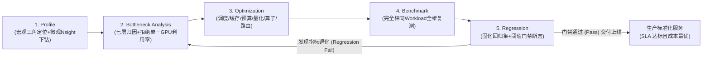

# 🏛️ 大模型服务工程化优化方法论：闭环交付与四维帕累托权衡 (Serving Methodology)

> **核心宗旨**：大模型推理服务（LLM Serving）的性能工程绝非盲目的调参拼凑，而是一门基于实证证据的闭环科学体系。  
> 完整的工业级推理优化必须严格遵循五步闭环方法论：  
> **Profile（全息画像） $\to$ Bottleneck Analysis（多维瓶颈诊断） $\to$ Optimization（靶向调优） $\to$ Benchmark（全维复测） $\to$ Regression（回归门禁）**。  
> 其终极目标是在 **Latency（低延迟）、Throughput（高吞吐）、Concurrency（高并发）与 Cost（经济成本）** 之间达成经过数学验证的可量化帕累托最优平衡（Pareto Optimal Trade-off）。

---

## 📑 目录

- [一、五步闭环方法论总览 (5-Stage Lifecycle)](#一五步闭环方法论总览-5-stage-lifecycle)
- [二、Stage 1: Profile (全息画像分诊)](#二stage-1-profile-全息画像分诊)
- [三、Stage 2: Bottleneck Analysis (多维瓶颈诊断)](#三stage-2-bottleneck-analysis-多维瓶颈诊断)
- [四、Stage 3: Optimization (靶向优化与量化权衡)](#四stage-3-optimization-靶向优化与量化权衡)
- [五、Stage 4: Benchmark (全维等权复测)](#五stage-4-benchmark-全维等权复测)
- [六、Stage 5: Regression (固化回归门禁)](#六stage-5-regression-固化回归门禁)
- [七、四维帕累托权衡数学模型 (Latency-Throughput-Concurrency-Cost)](#七四维帕累托权衡数学模型-latency-throughput-concurrency-cost)
- [八、本实验套件对应工具映射矩阵](#八本实验套件对应工具映射矩阵)

---

## 一、五步闭环方法论总览 (5-Stage Lifecycle)



---

## 二、Stage 1: Profile (全息画像分诊)

优化绝不盲目开始，必须先进行严谨的两级画像分析：
1. **服务级宏观三角分诊（Macro Triangulation）**：
   * **指标抓取**：Prometheus 实时打点或执行 `bash scripts/profile_service.sh --macro`。
   * **时间解耦**：将端到端延迟严格拆解为三个正交区间：
     $$\text{E2E Latency} = \text{Queue Time} + \text{TTFT (Prefill)} + \sum \text{ITL (Decode)}$$
   * **分诊判定**：若 Queue 占比高 $\to$ 调度队列问题；若 TTFT 占比高 $\to$ 算力密集问题；若 Decode 耗时长 $\to$ 显存带宽问题。
2. **微观工具深度下钻（Micro Profiling）**：
   * 借助 **PyTorch Profiler**（`scripts/torch_profiler.py`）定位算子级 CPU/CUDA 耗时与内存分配。
   * 借助 **Nsight Systems**（`nsys`）排查算子发射间隙（Launch Overhead）与 CPU↔GPU 同步等待（`cudaStreamSynchronize`）。
   * 借助 **Nsight Compute**（`ncu`）利用 Roofline 模型检查内核是否已打满硬件物理带宽。

---

## 三、Stage 2: Bottleneck Analysis (多维瓶颈诊断)

**绝不凭单一 GPU Core Utilization 下结论！** 必须将观察到的现象精准归类至七层架构之一：
* **Scheduler 层**：队头阻塞、并发序列配置不当（`max_num_seqs`）。
* **KV Cache 层**：前缀未复用、内存碎片膨胀、显存打满触发 CPU Swap 换出。
* **Memory Traffic 层**：模型参数过大，自回归单字生成显存带宽受限。
* **Quantization 层**：量化解包算力消耗（ALU 开销）与带宽节省的收益对比。
* **Kernel 层**：小算子驱动发射延迟（Host-bound）、CUDA Graph 未启用。
* **Communication 层**：PD 分离架构网络跳数、多卡 TP All-Reduce 延迟。
* **Platform 层**：WSL2 虚拟化 Pin Memory 缺陷、PCIe Gen3/Gen4 通道带宽限制。

*(详见技术白皮书：[docs/bottleneck_analysis_framework.md](file:///c:/Users/16472/OneDrive/Desktop/Documents/GitHub/vllm-serving-lab/docs/bottleneck_analysis_framework.md))*

---

## 四、Stage 3: Optimization (靶向优化与量化权衡)

依据 Stage 2 的诊断证据实施靶向调优，拒绝无根据的“参数玄学”：
* **调度与预算优化**：开启 Priority 消除 VIP 队头阻塞；调整 `max-num-batched-tokens` 预算平抑流式打字顿挫。
* **缓存拓扑优化**：启用 Radix Tree Prefix Caching，跨轮零拷贝复用物理块。
* **算子执行优化**：启用 CUDA Graph 录制，消除内核发射间隙。
* **量化优化四维综合考量**：
  * **Memory Traffic**：显存读取量减少（权重/KV 压缩）。
  * **Dequantization Cost**：评估解量化运算对算力的侵蚀（如 AWQ 需 ALU 解包，而 FP8 零额外开销）。
  * **Kernel Efficiency**：寄存器压力与共享内存利用率。
  * **Tensor Core Support**：硬件原生硬件加速（如 Ada/Blackwell 架构原生 FP8 Tensor Core）。

---

## 五、Stage 4: Benchmark (全维等权复测)

优化后必须在**完全相同的负载模型（Identical Workload）**下重新压测，严禁“换用简单 Prompt 证明加速”：
* **严守“五个固定”**：
  1. 固定 GPU 硬件型号与驱动版本（如 RTX 5080 Laptop, Driver 572.16）。
  2. 固定模型权重版本（Model Repo & Revision Commit SHA）。
  3. 固定输入/输出 Token 长度矩阵（128/128, 2048/128, 128/512）。
  4. 固定并发梯度（c = 1, 2, 4, 8）。
  5. 固定流量到达过程（Saturated Closed-loop 或 Poisson Process）。
* **拒绝“只看 Tokens/s”**：必须同步评估 **P99 TTFT（首字尾延迟）**、**P99 TPOT（逐字尾延迟）**、**P99 E2E 延迟**、**显存占用峰值**、**错误率/OOM 率** 与 **经济成本（$/1M Tokens）**。

---

## 六、Stage 5: Regression (固化回归门禁)

将高频生产业务负载固化为 **性能回归测试集（Performance Regression Suite）**：
* 任何局部优化（如开启激进量化或压缩预算）在上线前，必须执行自动化回归门禁：
  ```bash
  bash scripts/run_regression_suite.sh
  ```
* 回归断言器（[scripts/check_regression.py](file:///c:/Users/16472/OneDrive/Desktop/Documents/GitHub/vllm-serving-lab/scripts/check_regression.py)）自动对比候选版本与 Golden Baseline：
  * 若目标吞吐提升，但导致 **TTFT P99 恶化超过 15%** $\to$ **REGRESSION FAIL**！
  * 若单字速度加快，但导致 **OOM Rate > 0%** $\to$ **REGRESSION FAIL**！
  * 若显存节省，但导致 **单 Token 综合服务成本变高** $\to$ **REGRESSION FAIL**！

---

## 七、四维帕累托权衡数学模型 (Latency-Throughput-Concurrency-Cost)

在大模型推理架构中，优化没有“免费午餐”，本质是求解如下约束最优化问题：

$$\max_{\boldsymbol{\theta}} \quad \text{Throughput}(\boldsymbol{\theta}) \quad \text{s.t.} \quad \begin{cases} \text{P99 TTFT}(\boldsymbol{\theta}) \le \text{SLA}_{\text{TTFT}} \\ \text{P99 TPOT}(\boldsymbol{\theta}) \le \text{SLA}_{\text{TPOT}} \\ \text{Error Rate}(\boldsymbol{\theta}) = 0\% \\ \text{Cost per 1M Tokens}(\boldsymbol{\theta}) \le \text{Budget} \end{cases}$$

```
                           【四维帕累托平衡博弈面】
                                    Throughput
                                       ▲
                                      / \
                                     /   \
                                    /     \
                                   /       \
                                  /  PARETO \
                                 /  OPTIMAL  \
                                /             \
                       Latency ◄───────────────► Concurrency
                                \             /
                                 \           /
                                  \         /
                                   \       /
                                    \     /
                                     \   /
                                      ▼ /
                                     Cost
```

1. **吞吐量 vs 延迟（Throughput vs Latency）**：增大 Batch 尺寸能摊薄显存权重搬运开销，提升总体 Tokens/s，但会导致单个请求排队变长，恶化 TTFT 与 TPOT。
2. **并发容量 vs 显存溢出（Concurrency vs OOM Risk）**：调高 `gpu_memory_utilization` 允许容纳更多并发序列，但缩小了极端长文请求的瞬时缓存突刺安全边际，必须由 CPU Swap Space 兜底。
3. **性能 vs 成本（Performance vs Cost）**：全精度 BF16 无量化精度损失，但单 Token 显存与算力成本高达量化方案的 2~3 倍；FP8 动态量化在极小精度扰动下实现了成本减半与吞吐倍增。

---

## 八、本实验套件对应工具映射矩阵

| 方法论阶段 | 本项目落地执行工具 / 脚本 | 产出成果与交付物 |
| :--- | :--- | :--- |
| **Stage 1: Profile** | • `bash scripts/profile_service.sh --macro`<br>• `bash scripts/profile_service.sh --torch`<br>• `bash scripts/profile_service.sh --nsys` | • 宏观耗时三角分解<br>• Chrome Tracing 轨迹 (`torch_trace.json`)<br>• Nsight 算子时序图谱 |
| **Stage 2: Bottleneck Analysis** | • [docs/bottleneck_analysis_framework.md](file:///c:/Users/16472/OneDrive/Desktop/Documents/GitHub/vllm-serving-lab/docs/bottleneck_analysis_framework.md)<br>• 16 面板 Grafana 实时看板 | • 七层瓶颈归因定位<br>• 算力受限 vs 显存带宽受限判定 |
| **Stage 3: Optimization** | • 实验 1 ~ 实验 9 自动化矩阵 (`scripts/run_exp*.sh`)<br>• [compose.yaml](file:///c:/Users/16472/OneDrive/Desktop/Documents/GitHub/vllm-serving-lab/compose.yaml) / [compose.disaggregated.yaml](file:///c:/Users/16472/OneDrive/Desktop/Documents/GitHub/vllm-serving-lab/compose.disaggregated.yaml) | • 9 大核心推理架构优化实测收益<br>• 调度、缓存、量化、算子、拓扑调优 |
| **Stage 4: Benchmark** | • `bash scripts/benchmark.sh`<br>• `scripts/parse_benchmark_results.py` | • 包含 TTFT、TPOT、E2E、TPS、QPS、成本的标准 SLA 报告<br>• `results/baseline/summary.json` |
| **Stage 5: Regression** | • `bash scripts/run_regression_suite.sh`<br>• `python3 scripts/check_regression.py` | • 自动化性能回归报告 (`regression_report.json`)<br>• CI/CD 性能守门员 Exit Code (0/1) |
